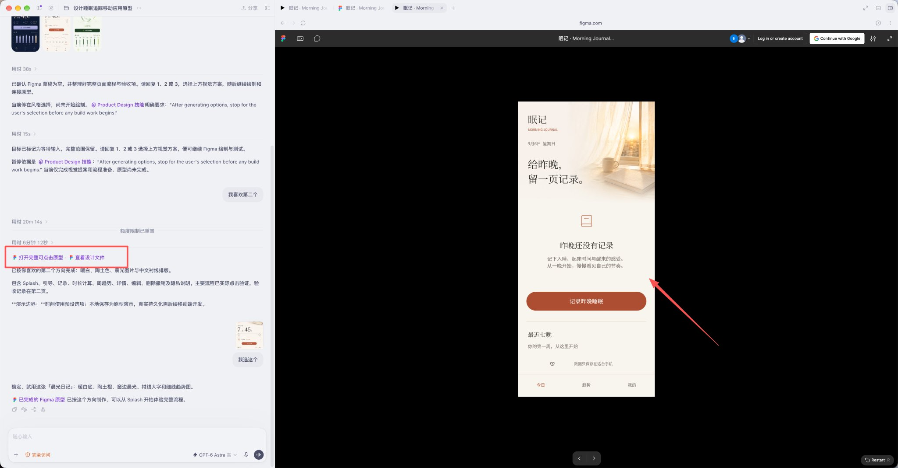
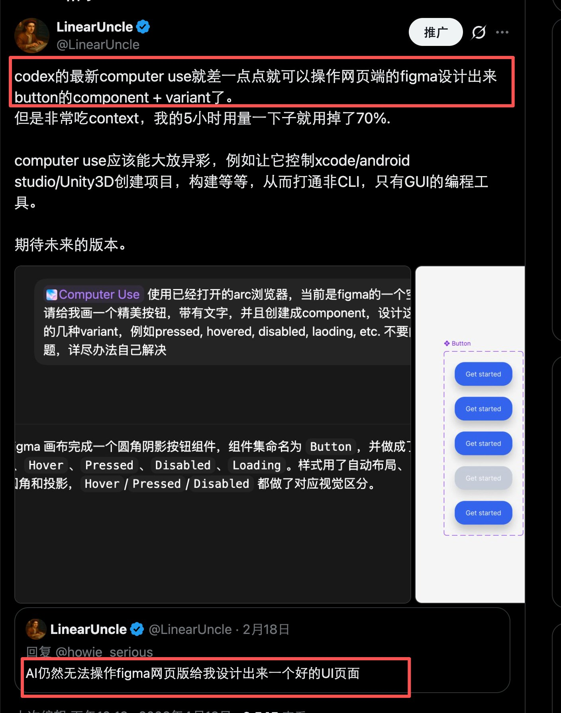

# 天呐，gpt-6 astra 真的可以操作 Figma 设计 UI 了！

- 作者：@LinearUncle（LinearUncle）
- 发布：2026-09-06　·　赞 337　·　浏览 83888
- 原帖：https://x.com/LinearUncle/status/2096513510939529670
- 模型：GPT-6
- 提示词位置：推文正文

## 原文

```
天呐，gpt-6 astra 真的可以操作 Figma 设计 UI 了！
我也实测了——真的可以。感谢原帖设计师提醒！

二月我还在感慨：AI 还不能靠 Figma 做出好看界面。
今天，这句话成历史了,我的界面提示词在图 1，注意使用/goal效果比较好。

做法其实很硬核：
1. Codex 通过 Figma Scripter 插件跑代码 → 调 Figma Plugin API → 生成可编辑的原生画板/图层，并配好原型跳转；
2. 晨光背景用 imagegen 生成后导入

3. 浏览器侧主要负责开插件、执行脚本，以及点原型做验证。
```

## 效果图




