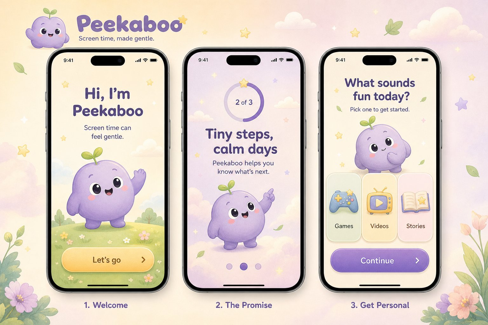
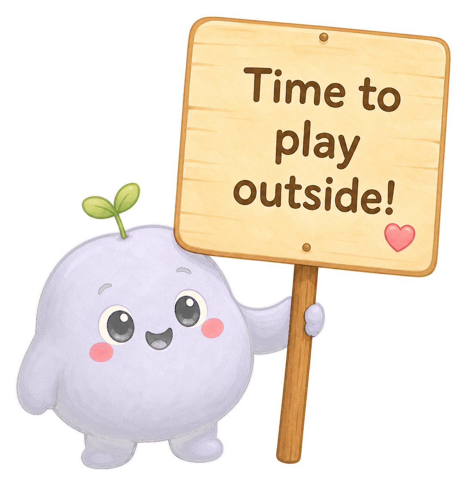

# I used @givros his awesome prompt to get thi

- 作者：@bas_fijneman（Bas Fijneman）
- 发布：2026-05-04　·　赞 72　·　浏览 6022
- 原帖：https://x.com/bas_fijneman/status/2051274432119701625
- 模型：GPT Image 2
- 提示词位置：推文正文

## 原文

```
I used @givros his awesome prompt to get this to life!

I want to recreate the Peekaboo mobile app — a gentle screen time app for kids.

The app must feel soft, calm, and emotionally safe. Every interaction should feel reassuring rather than punishing. The character (Peekaboo, a small purple blob with a sprout on its head) is the emotional anchor of the app.

The app must reproduce a satisfying, gentle mobile interaction system.

The UI must feel tactile, soft, and reassuring to navigate.

Screen layout:
- Render the app inside a phone frame mockup at 375x812 (iPhone 14 size).
- Use a safe area with a status bar at the top showing time, signal, wifi, battery.
- Place a fixed tab bar at the bottom with 4 tabs: Home, Timer, Rewards, Profile.
- Active tab uses the brand purple, inactive tabs use a soft muted gray.
- Each screen has its own scrollable content area between status bar and tab bar.
- Content should never touch the edges. Use generous 20px horizontal padding.

Idle state:
- The Peekaboo character has a subtle breathing animation (gentle scale 1.0 to 1.02 and back).
- Soft ambient elements drift slowly (clouds, sparkles, leaves).
- Cards and panels sit at rest with a soft drop shadow.
- All animations use easing, never linear motion.

Press state:
- When a button is pressed, it scales down to 0.96.
- Background color darkens slightly.
- Release returns to scale 1.0 with a gentle spring (overshoot to 1.02 then settle).
- Buttons must feel like soft silicone, not glass.

Swipe/scroll state:
- Vertical scroll has a soft rubber-band overscroll.
- Horizontal swipes between screens feel weighted and decelerate naturally.
- Scroll position must never feel jittery or instant.

Tab transition:
- Tapping a tab cross-fades content with a small upward slide (12px).
- The active tab indicator slides between positions, not teleports.
- Character poses can change between screens with a soft fade.

Animation:
- All movements must be smooth.
- Do not snap or teleport elements.
- Use interpolation for position, opacity, and scale.
- Use spring physics for press/release feedback.
- Character animations loop seamlessly.

Suggested UI element states:
- idle
- pressed
- active
- disabled
- success

Required screens:

1. Home screen
- Greeting at top: "Good morning, Alex!" with a small sun icon and date.
- Settings gear icon in the top right.
- Large rounded card showing "Today's screen time" with "1h 15m left of 2h 30m" and a circular progress ring around an illustration of Peekaboo sitting in grass with clouds and a sun.
- Streak banner at the bottom: "You're on a roll! 5 day streak" with a flame icon and chevron.

2. Timer screen
- Encouragement message at top: "Keep it up, Alex!" with a small heart.
- Large circular progress ring with the time remaining ("15:00 minutes left") in the center.
- Peekaboo character below, waving.
- "15 more minutes of fun!" pill button.
- Pause button and sound toggle at the bottom.

3. Break screen (when time is up)
- "All done! Time to take a break." headline.
- Peekaboo holding a wooden sign that says "Time to play outside!"
- Decorative stars and sparkles around the scene.
- Yellow pill button: "5 more minutes — Ask a parent" (with a lock icon).
- Green pill button: "I'm done! See you tomorrow!"

4. Rewards screen
- "Nice job, Alex!" with "You're doing amazing." subtitle.
- Weekly streak card with 7 day circles (M T W T F S S), filled stars for completed days.
- Sticker earned card: "You earned a sticker! Gardener Peekaboo" with the character holding a flowerpot and trowel.
- Unlocked rewards section with a progress bar (2 of 5) and 5 reward icon tiles in a row.

The final result should feel like a polished, production-quality kids app:
soft greetings, warm illustrations, gentle progress tracking, and reassuring micro-interactions.

Visual inspiration:
Use peekaboo_reference.png as the primary visual reference for layout and tone.

Also use the following art direction as inspiration:

Create high-quality hand-painted Ghibli-inspired mobile app assets for a cozy children's screen time app.

Character:
Peekaboo is a small, round, purple blob creature with a tiny green sprout growing from the top of its head. It has soft rosy cheeks, big black expressive eyes, and small stubby arms. The character should feel adorable, calm, gentle, and friendly. Never scary, never overstimulating. The character should feel emotionally safe for a 5-10 year old child.

Multiple poses needed:
- Sitting in grass, idle, with a soft smile
- Standing and waving with one arm raised
- Holding a wooden sign reading "Time to play outside!"
- Gardener pose, holding a small flowerpot with a trowel
- Celebration pose with arms up

Environment:
Soft pastoral backdrops painted in watercolor and gouache. Gentle hills, fluffy clouds, small flowers, soft grass, dappled afternoon sunlight. The world feels like a quiet sunlit afternoon in a Ghibli film. Add subtle bloom, soft fog, and floating particles for warmth.

App UI:
Render a polished cozy mobile app interface:
- a soft cream and lavender background
- rounded cards with subtle shadows
- generous whitespace and soft typography
- a clear bottom tab bar with 4 sections
- pill-shaped primary buttons
- circular progress rings with soft gradient strokes
- gentle iconography (home, timer, star, profile, settings, sound, pause, lock, heart, flame, sun)

Important:
All interface text must be in English.
Use short, friendly, encouraging labels such as:
- "Good morning"
- "Today's screen time"
- "Keep it up"
- "Time to play outside"
- "Nice job"
- "5 day streak"
- "You earned a sticker"
- "Unlocked rewards"
- "5 more minutes"
- "I'm done"

Avoid corporate, clinical, or stern wording. Tone is warm, gentle, never scolding.

Art style:
Hand-painted Ghibli-soft 2D illustration, watercolor and gouache textures, gentle ink outlines, polished cozy mobile app UI, dreamy storybook atmosphere, soft cinematic afternoon lighting, expressive character animation, and a premium app store feature look.
Use clean rounded shapes, clear readable silhouettes, soft shading, and a charming nostalgic visual style.
The design should feel more like a polished animated picture book than a painted illustration.
Use a warm pastel palette: cream, butter yellow, soft lavender purple, sage green, dusty rose, and sky blue accents.
The overall feeling should be cozy, gentle, magical, encouraging, and emotionally safe for children.

Composition:
9:16 portrait phone format for individual screens.
Phone-frame mockup composition for the marketing landing view.
Keep all UI clearly visible and within safe areas.
Make each screen feel like a polished feature shot from a cozy kids app.

Development requirements:
Develop the app using HTML, CSS, and JavaScript.

Split the project into as many files as needed to keep it modular, clean, and easy to improve.

The project must include an Assets folder.

Important asset rule:
Use only images placed inside the Assets folder.
Do not create visual assets with CSS shapes, emojis, SVG placeholders, or external images.
All visual assets must come from images generated with GPT Image 2.0.

Required assets to create with GPT Image 2.0:
- 1 app background (soft gradient with floating clouds, leaves, stars)
- 1 Peekaboo character — sitting in grass, idle pose
- 1 Peekaboo character — standing, waving
- 1 Peekaboo character — holding "Time to play outside!" sign
- 1 Peekaboo character — gardener with flowerpot
- 5 reward sticker icons (paint palette, book, cupcake, magnifying glass, gift)
- 1 set of tab bar icons (home, timer, star, profile)

Asset generation rule:
Each character pose and each sticker must be generated one by one.
Each must be a separate transparent PNG file.
Do not create a single sprite sheet.
Do not generate multiple poses in one image.
Each image must be usable independently in the app.

Playable demo requirements:
The demo must work directly by launching index.html.

The demo must include:
- A working bottom tab bar that switches between 4 screens.
- A live countdown timer on the Timer screen that updates every second.
- A circular progress ring that animates as time passes.
- Working press/release animations on all buttons.
- Animated character idle breathing on every screen.
- Smooth screen transitions between tabs.
- A streak display that reads from a small JSON config.
- A reward unlock progress bar.
- A modal or screen change when the timer completes (Break screen).
- Soft sound effects on button press (optional, mutable).
- Persistent state in localStorage (current screen time, streak, unlocked stickers).

Behavior:
- Tapping "15 more minutes of fun!" extends the timer by 15 minutes.
- Tapping "5 more minutes — Ask a parent" requires a 4-digit parent PIN modal.
- Tapping "I'm done!" returns to the Home screen with a celebration animation.
- The character pose changes contextually per screen.
- Decorative ambient elements (clouds, sparkles) drift slowly in the background.

Files:
Organize the code clearly, for example:
- index.html
- css/style.css
- css/animations.css
- js/main.js
- js/Router.js
- js/TimerManager.js
- js/StreakManager.js
- js/RewardManager.js
- js/CharacterAnimator.js
- js/StorageManager.js
- js/components/TabBar.js
- js/components/ProgressRing.js
- js/components/Button.js
- js/components/Modal.js
- js/screens/HomeScreen.js
- js/screens/TimerScreen.js
- js/screens/BreakScreen.js
- js/screens/RewardsScreen.js
- Assets/background.png
- Assets/peekaboo_idle.png
- Assets/peekaboo_waving.png
- Assets/peekaboo_sign.png
- Assets/peekaboo_gardener.png
- Assets/sticker_paint.png
- Assets/sticker_book.png
- Assets/sticker_cupcake.png
- Assets/sticker_search.png
- Assets/sticker_gift.png
- Assets/icon_home.png
- Assets/icon_timer.png
- Assets/icon_star.png
- Assets/icon_profile.png

The final result must respect the cozy Ghibli-soft Peekaboo theme and the gentle visual atmosphere described above.
Every label, message, and button in the UI must be written in English.
Tone must remain warm, encouraging, and never punishing.
```

## 效果图





