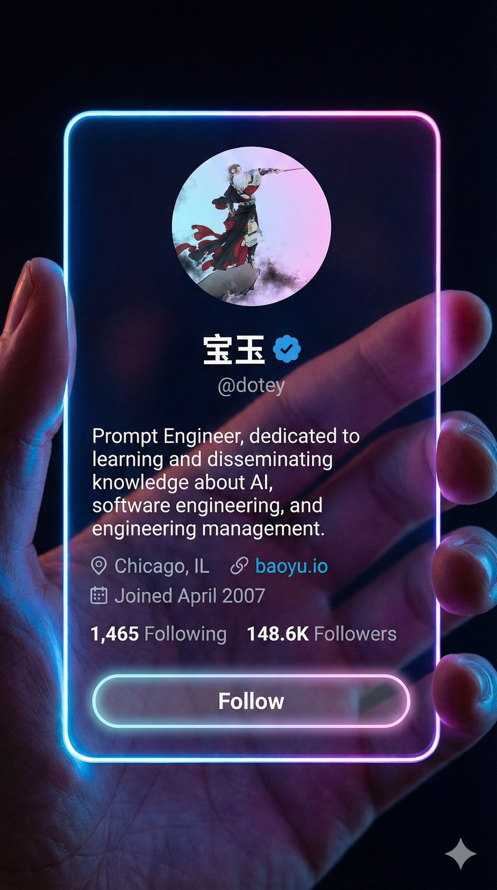

# nano banana prompt

- 作者：@dotey（宝玉）
- 发布：2025-12-01　·　赞 411　·　浏览 219799
- 原帖：https://x.com/dotey/status/1995633652139442373
- 模型：Nano Banana Pro
- 提示词位置：推文正文

## 原文

```
🍌 nano banana prompt

Convert your X profile to a cyber-aesthetic futuristic social-app interface.

Take a screenshot with your X profile, and send it to Gemini/nano banan pro with the prompt

--- Prompt ---

A 9:16 vertical, photorealistic cyber-aesthetic futuristic social-app interface. A hand is holding a vertical, iPhone-sized, borderless acrylic card, taking up most of the frame. The card displays a social media profile interface with no banners or background images. Its smooth, rounded edges emit a soft neon glow in blue, pink, and purple gradients.

The background is dark and blurred, emphasizing the glowing edges; the light reflections on the fingers feel cinematic and atmospheric, creating a high-tech holographic mood. The card surface is crystal-clear, and the profile details appear almost engraved, showing only the information from the reference image.

Displayed in this exact order:

- Profile avatar (centered)
- Name + blue verification badge (centered)
- Username with “@”, e.g., @dotey (centered)
- Bio (left-aligned)
- Location, website (left-aligned)
- Join date (left-aligned)
- Following count & followers count (left-aligned)
- Follow button (full-width, transparent background, rounded-full, border with soft neon glow)
```

## 作者补充的提示词

```
将你的 X 资料变成赛博卡片提示词
针对 nano banana pro 优化，使用时需要同时提供 X 资料截图

--- 提示词 ---

一张 9:16 竖版逼真的赛博美学未来社交软件界面照片：一只手拿着一张 iPhone 手机大小的竖直亚克力无边框卡片，占据了大部分画面。上面显示着一个社交媒体个人资料界面，但没有任何横幅或背景图片。卡片有平滑的圆润边缘，闪烁着柔和的霓虹灯光，呈现出蓝色、粉色和紫色的渐变。背景黑暗而模糊，以突出发光的边缘，握住卡片的手指上的灯光反射看起来富有电影感和氛围感，营造出一种高科技的全息氛围。卡片表面如水晶般清澈，个人资料的细节仿佛雕刻，只显示参考图中的信息。
按照顺序依次显示：
- 头像（居中）
- 名称和蓝色认证徽章（居中）
- 带有“@”的用户名，例如 @dotey（居中）
 - 个人介绍（左对齐）
- 地理位置、网站（左对齐）
- 加入日期（左对齐）
- 关注数和被关注数（左对齐）
- 关注按钮（w-full, bg-transparent, rounded-full, border-[闪烁着柔和的霓虹灯光]）
```

## 效果图


