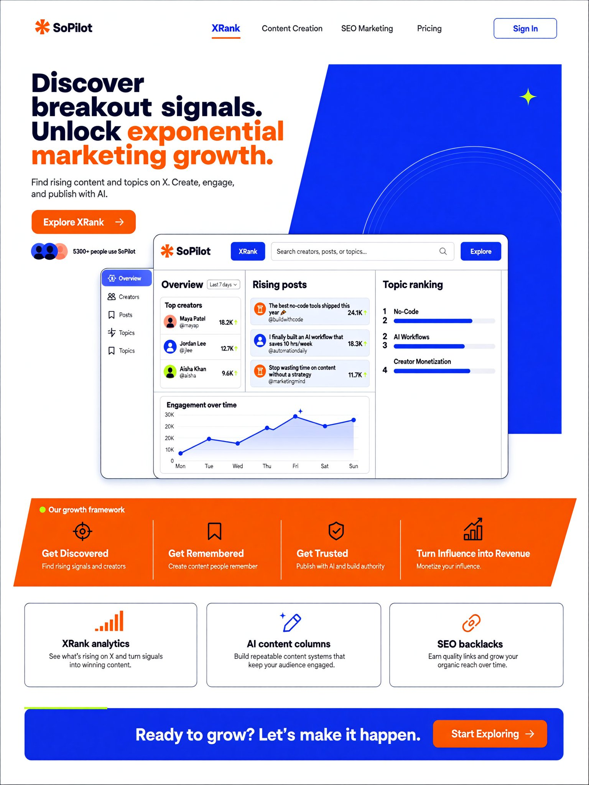
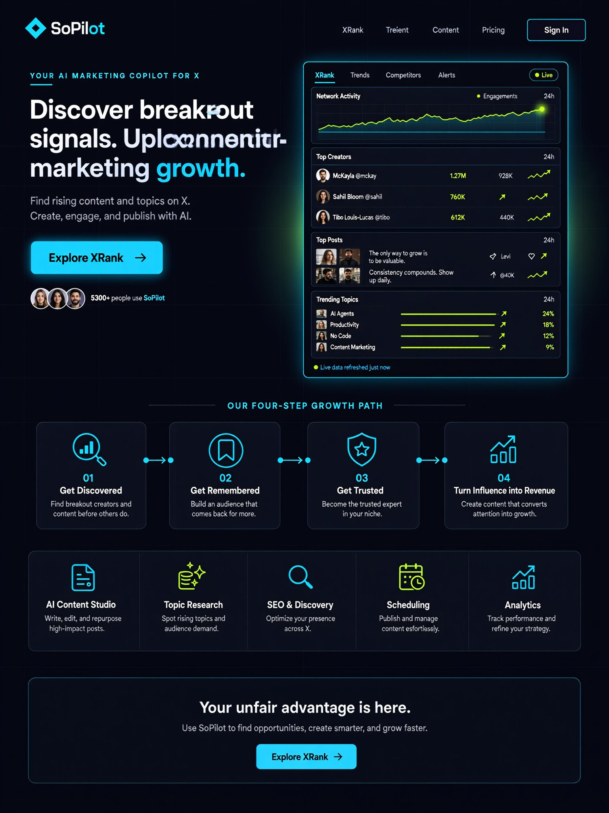
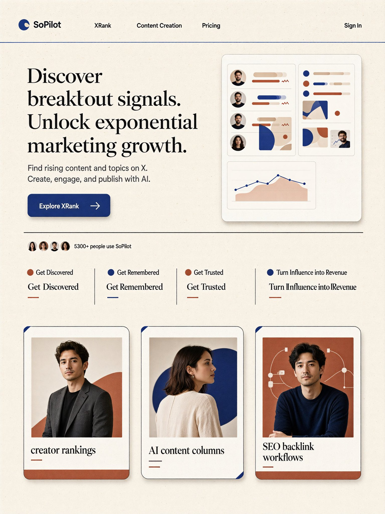

# 一个 6B 的国产开源图片模型，一出来就登顶 AA UI/UX Design 开源第一。

- 作者：@sven_ai（毅行出海）
- 发布：2026-10-04　·　赞 9　·　浏览 2218
- 原帖：https://x.com/sven_ai/status/2106641508959199730
- 模型：未标注
- 提示词位置：推文正文

## 原文

```
🔥 一个 6B 的国产开源图片模型，一出来就登顶 AA UI/UX Design 开源第一。

但我实际用下来发现：

比 Ming-Image-0.1-Design 模型本身更值得玩的，是他们一起开源的这个 UI Design Skill。

它可以一次给你生成 多套完全不同风格的高保真设计图。

先看设计，选方向。选中了，再让 Codex 去改代码。

我拿自己的产品试了一遍，发现这个工作流真的很爽。👇

最近我正好想重做 SoPilot 的落地页。

但做 UI 最麻烦的其实不是写代码。

而是：

你根本不知道自己想要什么。

「更高级一点」
「更有产品感」
「清爽一点」
「视觉冲击力再强一点」

这些需求用文字跟 AI 聊，很容易变成：
AI 改一版代码
→ 跑起来
→ 看效果
→ 不满意
→ 再改一版
→ 还是不满意……
本质上是在拿代码试设计。

直到我发现蚂蚁百灵开源的：Ling UI Design Skill 🔥

安装过程很简单，只要在 Codex 里说：
「安装这个 Skill：

然后 Codex 自己就装好了。

但装完以后我发现：这个 Skill 默认使用的是 Novita 的 Key 和接口。

但刚好 OpenRouter 可以免费使用2周 Ming-Image-0.1-Design 模型。

怎么办？以前可能要自己打开 Skill，看代码、找配置、改接口。

现在我直接跟 Codex 说：「把这个 Skill 改成使用 OpenRouter 的 Key 和接口。」

然后……Codex就自己把 Skill 改好了。😂

然后真正有意思的来了。

Ling UI Design Skill 不是简单地：“帮我生成一个好看的网页。”
它内置了 4 种设计方向：

Clean 清爽
浅色、大留白、冷灰表面、克制的蓝色点缀。

Warm 暖调
奶油色或石色、柔和对比、陶土色或橄榄色点缀。

Dark 深色
近黑背景、高对比文字、少量发光色和玻璃质感。

Bold 大胆
大标题、高饱和色块、强烈的图形对比。

🔥 所以我可以让 Codex：针对同一个页面，一次把几个方向的设计稿都跑出来，看看哪个效果好。

因为以前用 AI Coding 做页面，我经常遇到一个问题：

你跟它说：「做得高级一点。」

它就直接开始改代码。但“高级”到底是什么？

你不知道。AI 也不知道。

最后只能不断地：改代码 → 看效果 → 推翻 → 再改。

而 Ling UI Design Skill 相当于在 Coding 前面加了一层：
Design Exploration。

需求
↓
一次生成多个视觉方向
↓
快速比较
↓
选择一个方向
↓
继续细化设计
↓
最后再让 Codex 实现

这样就顺多了。

🔥 而且我觉得用这个 Skill 还有一个特别有意思的地方：

它本身也是可以继续进化的。

现在官方内置的风格是：Clean / Warm / Dark / Bold

但如果我自己尝试出了一种很好用的新风格，比如：

Editorial 编辑风
Swiss 瑞士风
Brutalist 粗野主义
Futuristic 未来科技风
Data-heavy 数据产品风

效果满意以后，再让 Codex：
「把这个设计风格加回 Ling UI Design Skill。」

下一次做其他产品，就可以直接复用。

于是整个过程变成：

使用 Skill
↓
发现新的设计风格
↓
不断测试
↓
找到好用的 Prompt
↓
沉淀回 Skill
↓
以后所有项目继续复用

🔥 这可能才是使用 Skill 最有意思的地方。

模型负责能力。
Skill 负责经验。
Coding Agent 负责执行。

而你在使用过程中积累下来的经验，又可以继续写回 Skill。
所以 Skill 不只是一个 Prompt。
它更像是：可以不断积累你工作经验的 AI 工作流。

以前：让 AI 直接改页面。
现在：先让 AI 当设计师，一次给我出几个方向。
我选一个。再让 AI 当工程师，把它做出来。
而且用得越多，Skill 还能越改越适合自己。

这个思路，我觉得比单纯“又出了一个更强的生图模型”有意思得多。🚀

Ling UI Design Skill：

Ming-Image-0.1-Design：

大家可以收藏起来，去试一试。
```

## 效果图




