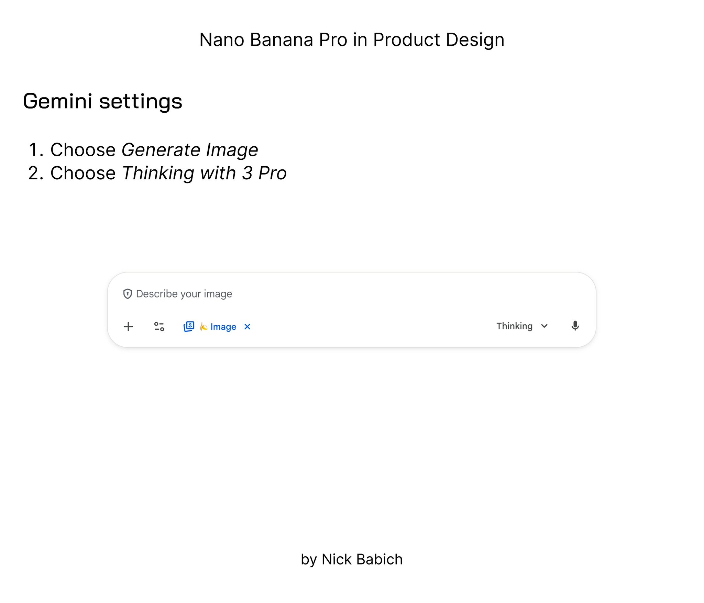
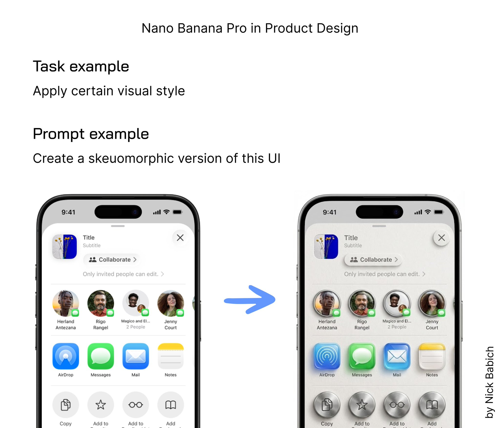
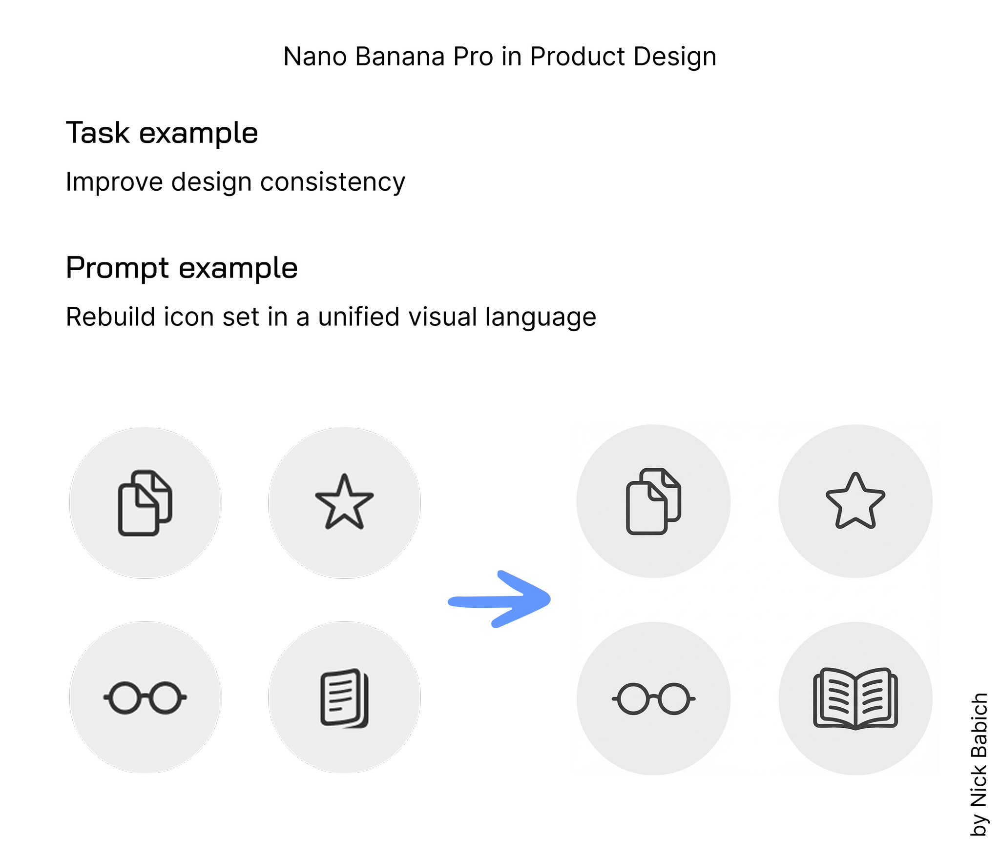
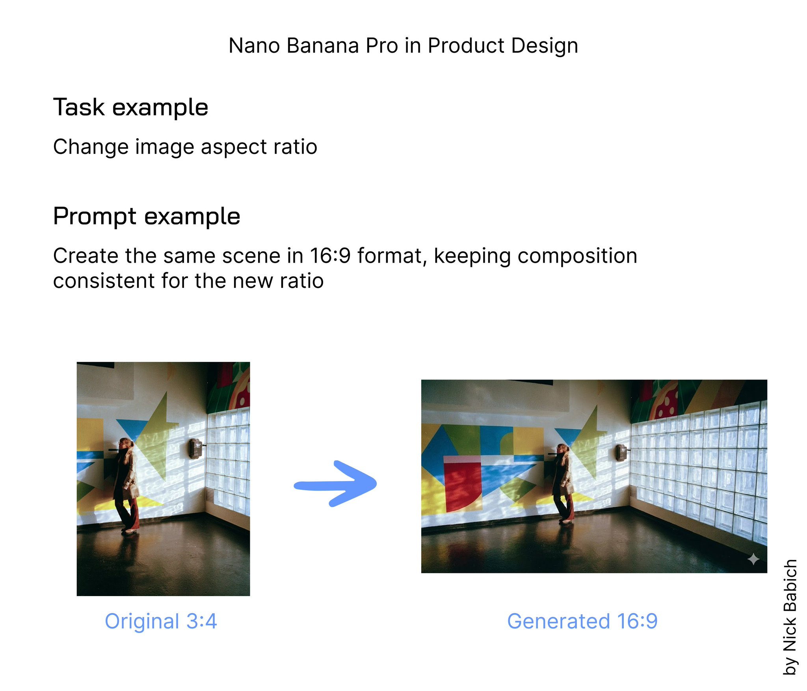

# 3 cases of using Nano Banana Pro for Product

- 作者：@101babich（Nick Babich）
- 发布：2025-11-21　·　赞 202　·　浏览 15496
- 原帖：https://x.com/101babich/status/1991875088774283769
- 模型：Nano Banana Pro
- 提示词位置：推文正文

## 原文

```
💎 3 cases of using Nano Banana Pro for Product Design Tasks

Google released its new AI image-generation model, Nano Banana Pro. Here is how you can use it in product design

1️⃣ Apply new visual style to existing imagery

You can apply visual style to both graphic images and UI.

Prompt example: Create a skeuomorphic version of this UI (attach screenshot)

2️⃣ Improve consistency of your design

You can use Nano Banana to optimise a set of images to make them look more consistent. For example, I use this tool to unify the icon set.

Prompt example: Rebuild icon set in a unified visual language (attach screenshot)

3️⃣ Change image aspect ratio

If you have an image in a certain ratio (say, 4:3) and want to make it in a different ratio (say, 16:9), Nano Banana can help you with that.

Prompt example: Create the same scene in 16:9 format, keeping composition consistent for the new ratio

#ai #nanobanana #NanobananaAI
```

## 效果图





