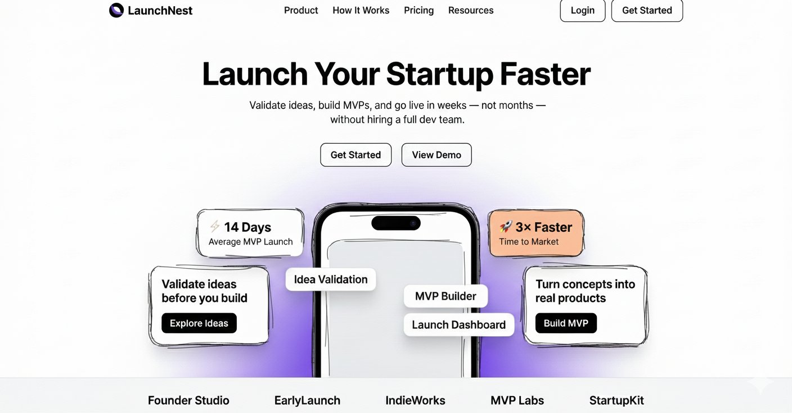

# I literally designed the landing page for a 

- 作者：@WoCStreet（Sri Ram）
- 发布：2026-01-05　·　赞 5　·　浏览 829
- 原帖：https://x.com/WoCStreet/status/2008084668097446153
- 模型：Nano Banana
- 提示词位置：推文正文

## 原文

```
I literally designed the landing page for a web app using google nano banana in under 2 minutes. And its looking awesome.

Prompt:

"Build a modern, production-ready SaaS landing page using Next.js (App Router) and Shadcn UI, based on the rough hand-drawn wireframe provided.

The wireframe represents layout and hierarchy only — transform it into a polished, premium SaaS design suitable for a real startup launch.

Website Description
Create a landing page for LaunchNest, a platform that helps founders validate startup ideas, build MVPs quickly, and launch faster without hiring a full team.

The page should feel:
Founder-focused
Fast and minimal
Premium but simple
Conversion-optimized
Think Stripe × Linear × early-stage startup energy.
Page Structure (Follow the Wireframe Exactly)
Sticky top navigation bar
Center-aligned hero section
Large headline (max 6 words)
Short supporting subheadline (1–2 lines)
Two CTA buttons near the hero text

A central mobile phone mockup partially visible from the bottom

Floating stat cards and info cards around the phone

Small brand/logo text placeholders at the bottom

Clean footer alignment

Do not change the layout — only improve visual quality.

Brand & Content (Use Exactly This Text)

Brand Name: LaunchNest

Navigation Bar
Product
How It Works
Pricing
Resources
Login (secondary, outlined)
Get Started (primary, filled)

Hero Section
Headline:
Launch Your Startup Faster
Subheadline:
Validate ideas, build MVPs, and go live in weeks — not months — without hiring a full dev team.

Primary CTA: Get Started
 Secondary CTA: View Demo
Floating Stat Cards

⚡ 14 Days Average MVP Launch
🚀 3× Faster Time to Market

Left Info Card

Validate ideas before you build
Button: Explore Ideas

Right Info Card

Turn concepts into real products
Button: Build MVP

Phone Mockup Overlay Labels
Idea Validation

MVP Builder
Launch Dashboard
Bottom Brand Placeholders

Founder Studio
EarlyLaunch
IndieWorks
MVP Labs
StartupKit

Color Palette

Primary Black: #0F0F0F
White: #FFFFFF
Muted Gray Text: #6B7280
Soft Gray Background: #F4F4F5
Accent Yellow Card: #FACC15
Accent Orange Card: #FB923C
Soft Purple Gradient: #E9D5FF → #F5E9FF
Design Principles
Large, bold hero typography
Generous spacing and padding
Strong visual hierarchy
Rounded cards with subtle shadows
Floating UI elements layered around the phone
Clean grid alignment
Looks great even with minimal content
UI & Component Requirements

Use Shadcn UI components:
Button
Card
Badge

Sticky navigation bar

Primary CTA: black background, white text
Secondary CTA: white background, black border
Phone mockup centered and partially cut off at bottom
Floating cards positioned absolutely relative to hero container

Fully responsive (mobile → desktop)

Technical Requirements:
Next.js App Router
Tailwind CSS
Clean, semantic HTML
Reusable components
No placeholder lorem ipsum
Output code only, no explanations"

Will try to bring this to life using Gemini 3 next.
```

## 效果图


