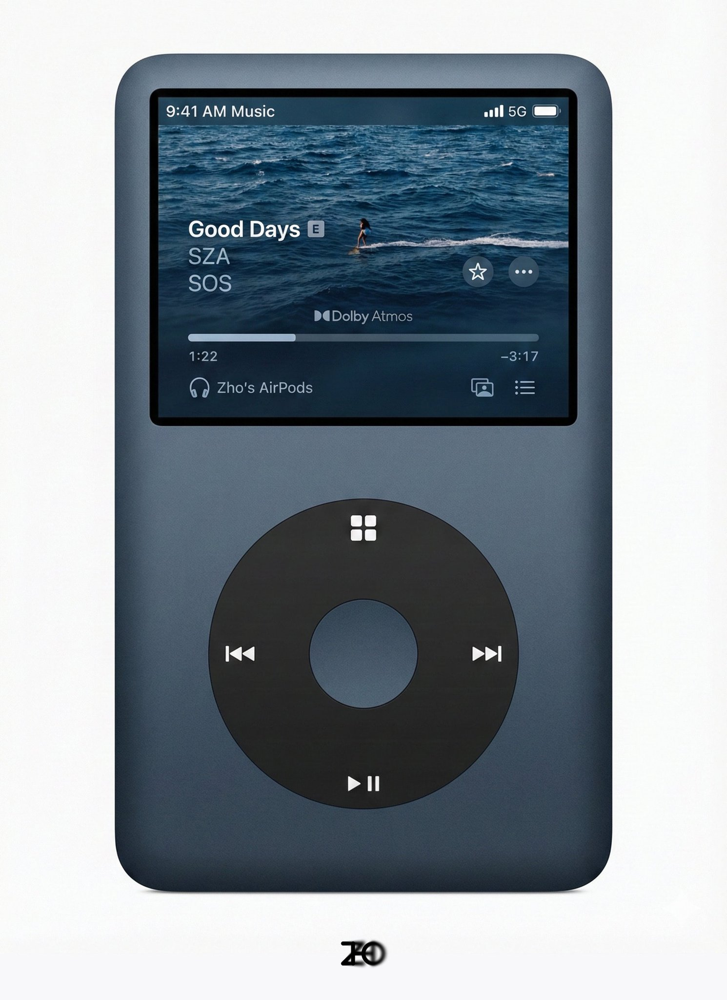

# 哇！这执行准确度！

- 作者：@ZHO_ZHO_ZHO（-Zho-）
- 发布：2025-11-26　·　赞 63　·　浏览 11755
- 原帖：https://x.com/ZHO_ZHO_ZHO/status/1993649538557673779
- 模型：Nano Banana Pro
- 提示词位置：正文只提到提示词（原文在配图/评论）

## 原文

```
哇！这执行准确度！

✅Nano Banana Pro 纯文字复刻 iPod

看来用文字做一些原型设计是有可能的了，材质质感、比例、文字、图标/符号、图片都很准确

ZHNO｜创意系列｜Nano Banana Pro

【Prompt】⬇️
```

## 作者补充的提示词

```
【Prompt｜ZHO 原创】注明出处 OK？！

3:4 as

A modern, sleek, dark blue-grey portable music player, similar to a re-imagined Apple iPod, is centered against a pristine white background. The device has gently rounded corners and a matte finish on its body.

The upper portion features a rectangular screen displaying a music playback interface. The top bar shows "9:41 AM Music" on the left and a "5G" signal indicator with a full battery icon on the right. The main display features album art depicting an abstract, dark blue ocean scene with small waves and a distant, indistinct figure on the water, possibly surfing. Overlaying the album art are the song details in white text: "Good Days" followed by an "E" (explicit) tag, "SZA" as the artist, and "SOS" as the album. Below this, the "Dolby Atmos" logo is visible. A progress bar indicates playback, with "1:22" elapsed time on the left and "-3:17" remaining time on the right. To the right of the progress bar are a star icon and an icon with three dots. Below the progress bar, a headphone icon and text "Zho's AirPods" indicate connected audio output. In the bottom right corner of the screen, there are two small square overlapping icons and three horizontal lines representing a playlist icon.

The lower half of the device features a large, tactile, circular control pad in a contrasting dark charcoal black. This pad has a smaller concentric circle in the center. White glyphs are positioned around the outer ring of the control pad: a grid of four small squares at the top, a double-left arrow (previous track) on the left, a double-right arrow (next track) on the right, and a play/pause icon (triangle pointing right between two vertical lines) at the bottom.

The lighting is soft and even, highlighting the device's textures and contours without harsh shadows, giving it a high-quality product photography aesthetic. The overall style is clean, minimalist, and realistic.
```

## 效果图


