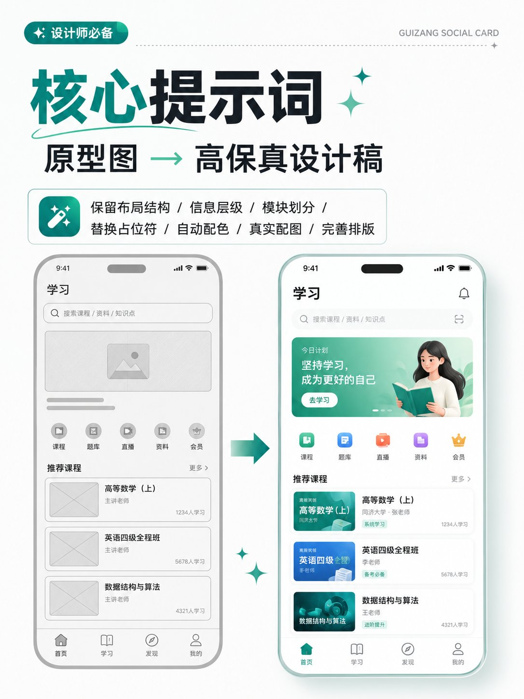
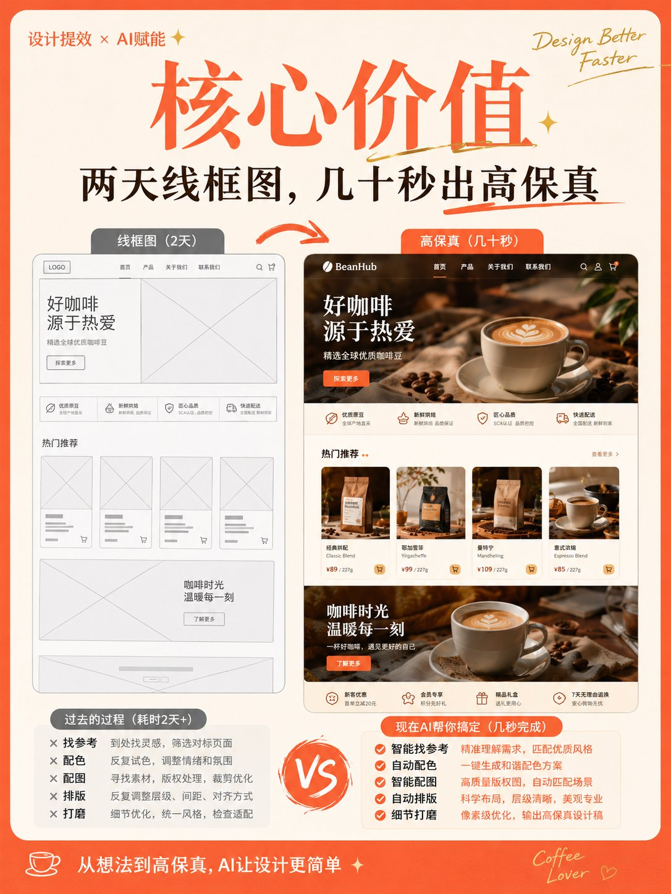

# 很多人以为 GPT-Image-2 最厉害的，是“从零画一张图”。

- 作者：@derek_wall90176（Derek Wen｜德里克文）
- 发布：2026-07-08　·　赞 47　·　浏览 4437
- 原帖：https://x.com/derek_wall90176/status/2074716166908772675
- 模型：GPT Image 2
- 提示词位置：推文正文

## 原文

```
很多人以为 GPT-Image-2 最厉害的，是“从零画一张图”。
但它更让设计师兴奋的一种能力，其实是把一张低保真原型图，直接抬升成一张可提案、可评审、可继续迭代的高保真设计稿。
以前从线框图到高保真，通常要经历找参考、定风格、补配色、换配图、调排版、补细节等等步骤。
现在很多时候，只要原型结构清楚，
GPT-Image-2 就能直接接管后半段工作流。
基于你原有的布局逻辑，继续往下完成视觉化表达。

🎯 核心提示词：

以上传的线框图 / 原型图为参考，生成一张高保真设计稿。

设计类型：【运营活动页 / App界面 / H5页面 / 电商详情页 / 官网页面 / 信息图】

要求：
1. 保留原始页面的布局结构、信息层级和模块划分
2. 将线框图中的占位符替换为真实内容
3. 自动补充配色、图片、图标和排版细节
4. 强化页面的视觉层级、留白、对齐和模块关系
5. 整体输出为高完成度的高保真设计稿

视觉风格：【简约现代 / 科技感 / 轻拟物 / 清新 / 品牌感 / 高级感】
主色调：【填写颜色】
辅色：【填写颜色】
画幅比例：【如 9:16 / 4:3 / 16:9】

注意：
保留原始结构，不要随意打乱模块顺序。
重点优化视觉表现和真实内容呈现，使其像一张可用于提案展示的完整设计稿。

如果你想让结果更稳，还可以补一句：

保持线框图原有的信息架构不变，只提升视觉完成度与真实感。

💡 核心逻辑

它的价值主要来自三个层面。

1. 把“结构思考”和“视觉表达”接起来

低保真原型图最重要的是结构：

模块怎么分
信息怎么排
优先级怎么走
用户先看什么，再看什么

而高保真设计稿最重要的是表达：

颜色怎么建立品牌感
图片怎么提升氛围
字重、字号、留白怎么形成节奏
页面怎么看起来“完整且专业”

原型图变高保真，本质上是在做一件事：

保留你的逻辑，补足你的表现。

2. 它不是“重新画”，而是“继续设计”

很多人对 AI 有个误解：

以为它一出手，就会把原图改得面目全非。

但这类玩法真正稳定的关键，恰恰是要反复强调：

保留原始布局
保留模块结构
保留信息层级
只把占位符替换成真实内容
只提升视觉完成度

一句话理解：

不是让 AI 推翻你的原型，而是让它像一个视觉设计师，接着你的 wireframe 往下做。
```

## 效果图





