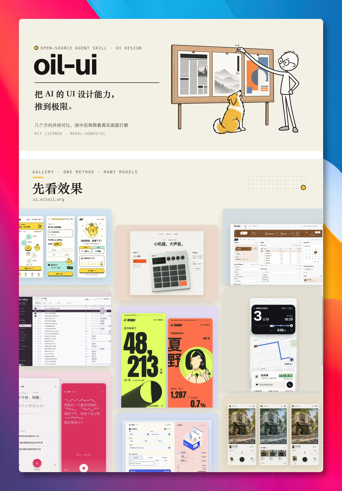

# 让 AI 做个页面，经常是同一套模样，渐变紫、居中大标题、三张圆角卡片，一眼就能认出是 

- 作者：@GitHub_Daily（GitHubDaily）
- 发布：2026-10-06　·　赞 61　·　浏览 6830
- 原帖：https://x.com/GitHub_Daily/status/2107372841180311578
- 模型：未标注
- 提示词位置：配图内文字（正文没写，需看图抄）

## 原文

```
让 AI 做个页面，经常是同一套模样，渐变紫、居中大标题、三张圆角卡片，一眼就能认出是 AI 做的。

最近看到 oil-ui 这个 Skill，专门用来提升 AI 的 UI 设计水平，先认清这是什么产品，找同类里风格最鲜明的两三家拆开看，再决定沿用什么、换掉什么。

动手前先从能量、完成度、密度、分量、严肃度 5 个刻度定调性，「高级」「简洁」这类空词会被翻成用什么字、留多少白、颜色占多大面积。

GitHub：

几份小样会放进同一个对比页，能切电脑和手机尺寸，看中了点「选择」，复制一句话贴回给 Agent 就接着往下做。

几个方向之间还要拉开差别，骨架、字体、色彩、主视觉 4 项里最多 1 项相同。

官网画廊里有学英语 App、打车 App、胶片相机官网这些作品，可以先去看效果。

开源版装上就能用，不需要额外的 API Key。想让 AI 做的页面别那么千篇一律，可以拿它试试。
```

## 效果图


