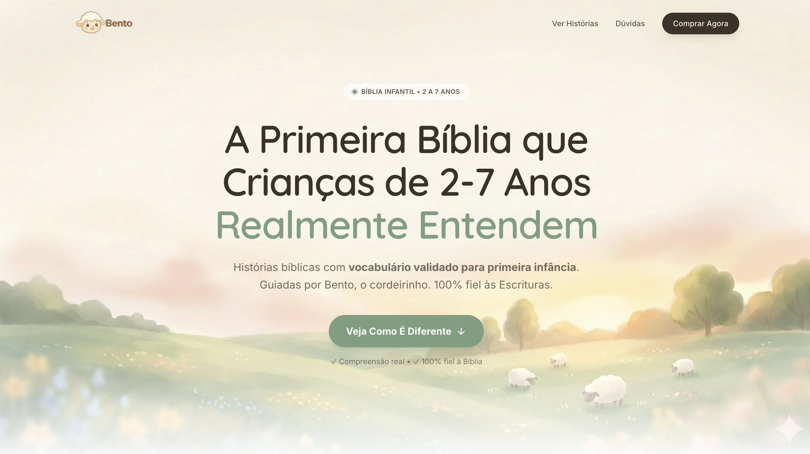

# Usei o mesmo processo pra criar essa landing

- 作者：@brunobertolini（Bruno Bertolini • awesome.codar.me）
- 发布：2026-03-27　·　赞 188　·　浏览 22276
- 原帖：https://x.com/brunobertolini/status/2037649149009760368
- 模型：Nano Banana
- 提示词位置：推文正文

## 原文

```
Usei o mesmo processo pra criar essa landing page. Sem designer. Sem template.

O problema de pedir pra IA "cria uma landing page pra mim" é que ela vai criar. E vai ficar genérica. Parece site de dentista feito no Wix em 2019.

O que muda o resultado é o que você faz antes de pedir. Apliquei o framework exatamente assim pra essa LP:

RESEARCH - REFERÊNCIA VISUAL: Antes de escrever uma palavra, defini o clima da página. Paleta de cores (tons pastel, creme, rosa chá, verde menta), referência de estrutura, e o tipo de sensação que a página precisava passar. No caso, era um produto infantil cristão, precisava ser acolhedor, limpo, leve (sendo honesto, essa parte minha esposa que fez e me passou o que ela queria). Eu juntei algumas referências visuais e mandei pro Claude junto com o briefing.

Sem referência visual, a IA chuta. Com referência, ela executa.

PRD - ESTRUTURA E CONTEÚDO: Ainda no Claude, fui definindo seção por seção. Não cheguei com a estrutura pronta, fui conversando. "Precisa de newsletter?" "Mostra todos os livros ou só os lançados?" "A bio da autora foca em credencial ou em história pessoal?"

A IA me questionou em decisões que eu ia tomar no automático. Tipo a foto do about: eu ia colocar uma foto da família inteira. O Claude sugeriu só mãe e filha, porque o público são mães e a identificação é imediata.

Saí dessa etapa com: estrutura completa de seções, textos de cada bloco, paleta com hex codes, tipografia, espaçamento.

EXEC -  PROMPT DETALHADO PRO AURA: Aqui é onde a maioria começa. E por isso o resultado fica genérico.

Primeiro, gerei a imagem de hero no Nano Banana, depois, com tudo definido antes, montei um prompt que descrevia cada seção com: texto final, cor de background, cor de botão, fonte, tamanho, estilo de card. Colei no  que é melhor que o stitch ou qualquer outra tool pra LP,  e saiu a LP inteira de primeira.

QUALITY GATE - REVISÃO: Olhei a página pronta e fui impiedoso. Tudo que não tinha informação real, tirei. Placeholder de qualquer tipo saiu. Se não tá pronto, não mostra. Depois passei no  pra revisar posicionamento e estrutura de conversão, copy...

O ponto é: LP bonita com IA não é sobre a ferramenta. É sobre o que você alimenta ela antes de pedir. Um designer faria melhor? Sem dúvidas, mas eu nunca seria capaz de criar isso sem AI.

Referência visual → Estrutura com a IA → Prompt detalhado → Execução → Revisão.
```

## 效果图


