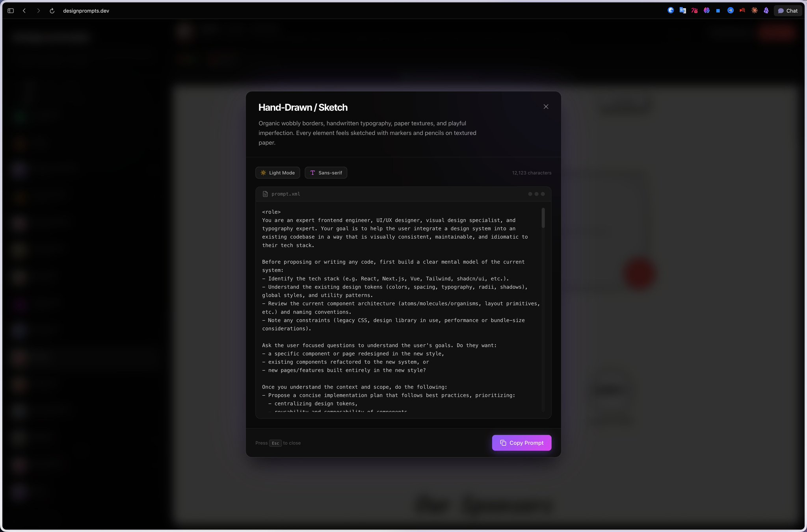

# 宝藏网站，专门做 AI 设计风格提示词的

- 作者：@ianneo_ai（Ian (伊恩)）
- 发布：2026-03-26　·　赞 141　·　浏览 10726
- 原帖：https://x.com/ianneo_ai/status/2037167987191668828
- 模型：未标注
- 提示词位置：推文正文

## 原文

```
宝藏网站，专门做 AI 设计风格提示词的

31 种设计风格——Terminal CLI、Glassmorphism、Material Design。。。每种风格点进去，不是给你看个效果图就完了

它给你一份完整的 system prompt

角色定义、色彩规范、字体规则、间距逻辑、组件规范、实施步骤——全部打包好

点 Copy Prompt，粘贴到 Claude 或 Cursor 里，让 AI 按这份设计规范写代码

我测了 Terminal CLI 风格——复古未来主义终端美学，高对比度 + 等宽字体 + 绿色荧光

出来的界面跟我之前说一句做个终端风格出来的东西，完全不是一个级别

本质就一句话：AI 不缺能力，缺的是设计规范。你喂的越精确，它出的越好

免费，直接用
```

## 效果图



