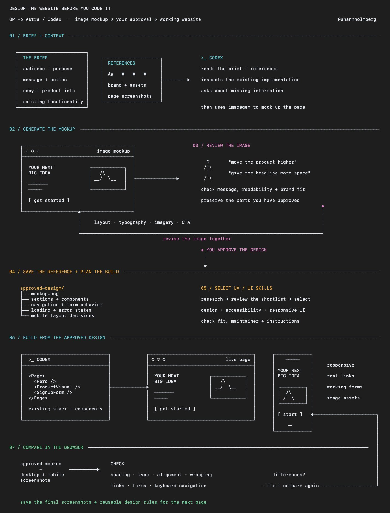

# how to improve GPT-6 Astra / Codex's ability

- 作者：@shannholmberg（Shann³）
- 发布：2026-09-21　·　赞 860　·　浏览 90934
- 原帖：https://x.com/shannholmberg/status/2102163474709389562
- 模型：GPT Image / GPT-6
- 提示词位置：推文正文

## 原文

```
how to improve GPT-6 Astra / Codex's ability to design and code websites

I've been using this approach since GPT Image was released, and the results have kept improving with 2 and 2.5

the idea is to have Codex generate visual mockups of the website before building it, whether you're reimagining an existing page or starting with an idea from scratch

you can review the layout, give feedback and agree on the design before it starts writing the frontend

here's how to use it:

1. give Codex the idea and your context

explain who the website is for, what it needs to communicate and what you want someone to do when they visit

include the material you already have:

> your page copy and product information
> brand guidelines, fonts, colors and assets
> screenshots of the existing page if you're redesigning
> references with notes on what you like about each one

have it ask about anything missing before generating the mockup

for an existing website, ask it to inspect the current implementation too, including components and functionality that need to stay

2. ask it to generate the design first

be explicit that you want an image mockup to review before implementation

a starting prompt:

> use imagegen to create a website mockup from this brief and the attached references
> use the supplied copy, brand assets and product information
> show the page layout, typography, imagery and calls to action, and wait for my feedback before writing code

you can request different visual directions if you're still exploring, with each version changing something meaningful like the layout or use of imagery

3. work through the mockup together

review it as a page someone needs to understand and use

> is the main message clear?
> does the layout guide attention toward the intended action?
> is the text readable?
> does the design fit your brand?
> are there generic sections or invented details that should be removed?

give specific feedback on the image, such as increasing the space around the headline, reducing decorative elements or moving the product example higher on the page

ask it to revise the chosen mockup while preserving the parts you've approved

4. turn the approved mockup into a build plan

have Codex identify the sections, reusable components and assets needed to implement the design

agree on what happens when someone interacts with it, including navigation, forms, buttons and any loading or error states

also define how the layout should adapt to mobile, because a desktop mockup leaves those decisions open

save the approved image and your decisions in the project so Codex can refer to them during the build

5. find relevant UX / UI skills before building

you can find these in skill directories and through recommendations on X, UI Skills is one example to explore

give your Grok Bot the project brief and have it research which skills are popular and worth considering for your stack

ask it to check what each skill does, who maintains it and whether its instructions fit the website you're building

that could include skills for:

> frontend design and component patterns
> accessibility and responsive layouts
> animation and interaction design
> reviewing the finished UI

review the shortlist, then give Codex the selected skills alongside your design system and approved mockup before implementation

6. build the page from that reference

ask Codex to implement the approved design using your project's existing stack and components where appropriate

keep headings, buttons and forms as working website elements, with illustrations and other generated visuals saved as separate assets

a useful implementation prompt:

> build the approved mockup as a responsive page
> preserve its layout, spacing, typography and visual hierarchy, use the approved copy and implement the interactions we agreed
> flag anything that needs a design decision before changing it

7. compare the rendered website with the mockup

have Codex open the implemented page in a browser and capture screenshots at desktop and mobile sizes

compare those screenshots with the approved design and work through the differences

check spacing, font sizes, image proportions, alignment and text wrapping, then test the links, forms and keyboard navigation

after you've reviewed the page, save the final screenshots and reusable design rules with the project for the next page you build
```

## 效果图


