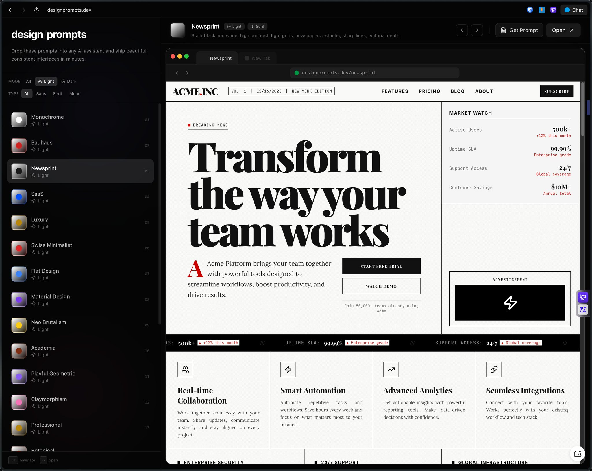

# 发现一个设计神器！

- 作者：@ttmouse（ttmouse - 豆爸）
- 发布：2025-12-15　·　赞 348　·　浏览 52296
- 原帖：https://x.com/ttmouse/status/2000602654490407265
- 模型：未标注
- 提示词位置：推文正文

## 原文

```
发现一个设计神器！

你可以直接用这些设计提示词来改造你的产品。

里面打包了30+种经典网页设计风格

比如报纸风、黑白极简、包豪斯、SaaS现代感、奢华风……

每种风格都用同一套数据渲染出完整界面

视觉对比超强！

最爽的是：

每个风格的完整提示词都能直接复制！

用法简单粗暴：

选一个喜欢的风格

点“Get Prompt”复制提示词

粘到Grok或其他AI里

再描述你的产品需求

让AI瞬间帮你改造UI，换新风格

国外开发者用Claude Opus生成的

质量高到爆

设计师、产品人、独立开发者直接收藏！

谁已经试过了？

改造前后对比发来看看？

来自 @0xbisc 的分享。

#DesignPrompts #AIDesign #提示词 #UI改造 #产品工具
```

## 效果图


