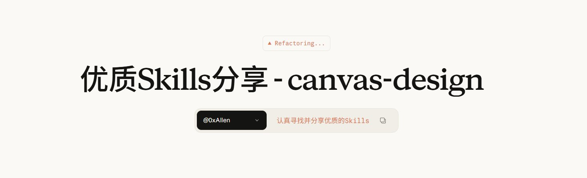

# 这个 Skill 一出，Logo设计师可以下岗了！

- 作者：@0xAllen（0xAllen）
- 发布：2026-03-03　·　赞 1827　·　浏览 174674
- 原帖：https://x.com/0xAllen/status/2028724796230635684
- 模型：未标注
- 提示词位置：配图内文字（正文没写，需看图抄）

## 原文

```
这个 Skill 一出，Logo设计师可以下岗了！

小米当时花了几百万请日本设计师改Logo，最后大家评价改了个寂寞。设计的玄学就是这么强。

最近在重构灯塔时需要新Logo，作为 AI 的重度用户就拉着AI一起来设计新Logo，前后30分钟从哲学思想到视觉设计一个Skill搞的明明白白的，最关键设计我很喜欢！

这个 Skill 就是：canvas-design

和一般设计不同的是，用canvas设计可以从哲学思想到视觉效果进行深度沟通以后直接出图。他不是简单的你让画啥就画啥，而是先从灵魂深层理解你的诉求最后再完成设计。

比较爽的是，一键生成PNG、SVG以及各种各样的布局和尺寸。安装使用方法也很简单：

npx skills add https://github。com/anthropics/skills --skill canvas-design --agent claude-code -y
```

## 效果图


