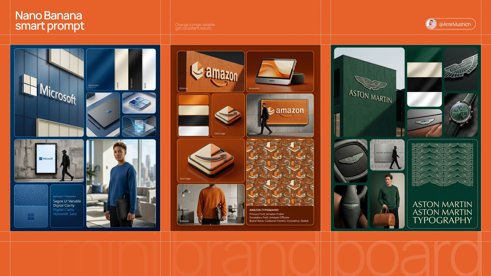

# Nano Banana branding prompt:

- 作者：@AmirMushich（AmirMušić）
- 发布：2026-03-05　·　赞 257　·　浏览 28791
- 原帖：https://x.com/AmirMushich/status/2029563852136849515
- 模型：Nano Banana
- 提示词位置：正文只提到提示词（原文在配图/评论）

## 原文

```
Nano Banana branding prompt:

Brand DNA board

Prompt 👇
```

## 作者补充的提示词

```
Prompt:
(access Nano Banana 2 here:

[BRAND NAME]. Act as a Senior AI Visual Strategist & Creative Director.
Goal: Generate a grid-based brand identity showcase.
PHASE 1: COMPOSITION & LAYOUT
Set the scene on a deep, rich [BRAND PRIMARY COLOR] background. Implement an 8-module grid with rounded corners and thin separation lines.
- Large Modules: Top Left and Bottom Right.
- Small/Medium Modules: Fill the remaining space.
PHASE 2: AUTONOMOUS BRAND LOGIC (THE CORE) [INSTRUCTIONS FOR IMAGEN]:
Analyze the name "[BRAND NAME]".
Determine the industry (e.g., Tech, Luxury, Eco, Automotive, Fashion).
Do NOT default to sports/tennis unless the brand name explicitly requires it.
Adapt all secondary elements (accessories, textures, model's activity) to match this industry.
PHASE 3: MODULE CONTENT (DYNAMIC ADAPTATION)
- MODULE 1 (Exterior): A flagship building façade. Use textured walls in [BRAND PRIMARY COLOR]. Feature a large [BRAND NAME] wordmark and a geometric abstract logo in a contrasting Cream/Beige.
- MODULE 2 (Colors): A vertical swatch panel. Sequence: [BRAND PRIMARY COLOR], Cream, Deep Black, White. Satin finish.
- MODULE 3 & 5 (Core Logo): Detailed close-ups of the brand's unique geometric icon.
- MODULE 4 (Accessory): AUTONOMOUS CHOICE. If [BRAND NAME] is Tech, show a sleek device. If Luxury, show a watch or jewelry. If Eco, show sustainable packaging. Must be in brand colors.
- MODULE 6 (Urban): A street-level mockup on a concrete wall. A person in an all-black outfit walks past a branded panel.
- MODULE 7 (Editorial): A high-end lifestyle shot.
  - Model: Professional, editorial style.
  - Outfit: Premium sweatshirt in [BRAND PRIMARY COLOR] with brand logo.
  - Prop: AUTONOMOUS CHOICE based on industry. (e.g., a leather briefcase for Finance, a camera for Media, a designer bag for Retail).
- MODULE 8 (Specs): Top half: A complex repeating pattern based on the brand logo. Bottom half: Four lines of text " [BRAND NAME] TYPOGRAPHY" in a clean, high-end sans-serif.
PHASE 4: LIGHTING & TEXTURES
- High-End Editorial Photography. No "AI-plastic" look.
- Cinematic soft-box lighting with Rembrandt shadows.
- Micro-details: fabric weave, skin pores, concrete grit, leaf veins.
- Subsurface scattering on organic materials.
PHASE 5: TECH SPECS
8K Resolution, Octane Render style, Ray Traced reflections, subtle film grain.
```

## 效果图


