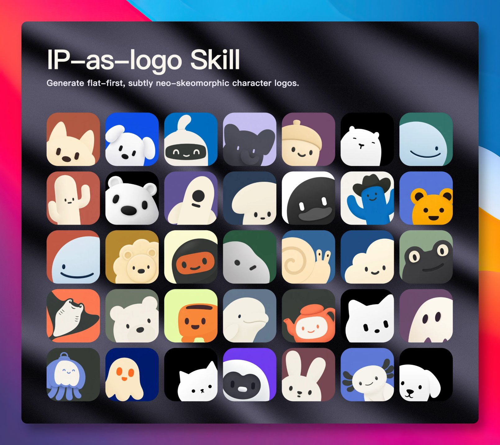

# 我一直觉得用 AI 画 Logo 最大的毛病是画得太满，细节一多，缩成 App 图标就糊

- 作者：@GitHub_Daily（GitHubDaily）
- 发布：2026-09-26　·　赞 106　·　浏览 9196
- 原帖：https://x.com/GitHub_Daily/status/2103696085411897400
- 模型：Nano Banana Pro / GPT Image 2
- 提示词位置：配图内文字（正文没写，需看图抄）

## 原文

```
我一直觉得用 AI 画 Logo 最大的毛病是画得太满，细节一多，缩成 App 图标就糊成一团。

ip-as-logo 这个 Skill 反着来，只画圆滚滚的吉祥物，四到七个大块形状拼出轮廓，两种主色加一个纯色背景，多余的线条都删掉。

先给三个方向，点头后一次出 6 张，三张从左下角探出来，三张从右下角，要配 GPT Image 2 或 Nano Banana Pro 这类生图模型用。

不想折腾 Skill 的，可以查看它官网上有现成的，都能免费商用。

GitHub：
```

## 效果图


