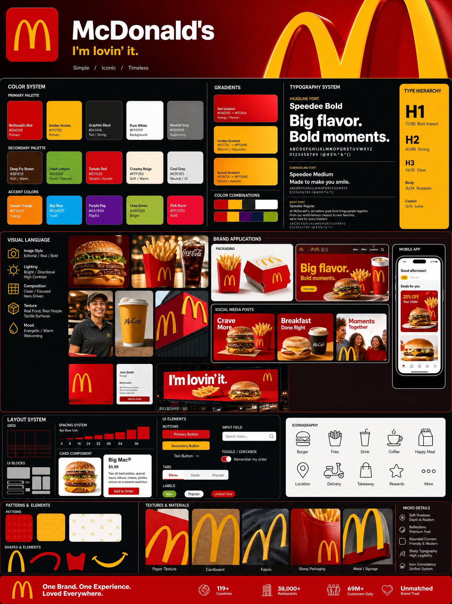

# GPT Image 2

- 作者：@Just_sharon7（Sharon Riley）
- 发布：2026-05-02　·　赞 1198　·　浏览 69982
- 原帖：https://x.com/Just_sharon7/status/2050479284075262340
- 模型：GPT Image 2
- 提示词位置：推文正文

## 原文

```
GPT Image 2

{
  "prompt": {
    "title": "Agency-Grade Brand Identity System Poster",
    "trigger": "Upload a logo. From it, construct a complete, investment-worthy brand identity system poster — the kind that closes client deals and dominates Behance front pages.",

    "prime_directive": {
      "rule": "Every element — color, tone, shape, texture, personality — must be extracted directly from the uploaded logo.",
      "enforcement": "Nothing generic. Nothing templated. Nothing borrowed. Strip the logo. Decode it. Build an entire visual universe from its DNA."
    },

    "format": {
      "orientation": "Vertical",
      "aspect_ratio": "4:5",
      "layout": "Multi-column grid",
      "composition": "Layered, dense, intentional — zero wasted space"
    },

    "sections": {

      "01_brand_header": {
        "label": "Open With Authority",
        "elements": [
          "Brand name in commanding, high-hierarchy typography",
          "Brand statement — 6 words maximum, razor-sharp",
          "Three soul descriptors (e.g. Raw / Futuristic / Grounded)"
        ]
      },

      "02_color_system": {
        "label": "Build The Color World",
        "palettes": {
          "primary": "3–5 colors extracted from logo",
          "secondary": "3–5 supporting colors",
          "accent": "High-impact hit colors"
        },
        "per_color_display": [
          "Wide swatch block",
          "HEX code",
          "Role label: foundation / emphasis / atmosphere"
        ],
        "extras": [
          "Gradient blends",
          "Color-on-color pairings",
          "Light mode vs dark mode behavior"
        ]
      },

      "03_typography_system": {
        "label": "Establish The Type Voice",
        "tiers": {
          "headline": "Commanding, bold — show a punchy title example",
          "subheadline": "Structured, clear — show a descriptive line example",
          "body": "Readable, intentional — show a paragraph fragment example"
        },
        "requirement": "Hierarchy must be undeniable at a glance"
      },

      "04_visual_language": {
        "label": "Define The Visual World",
        "define": [
          "Image style (editorial / industrial / cinematic / organic / etc.)",
          "Lighting quality and direction",
          "Texture references and material moods"
        ],
        "visual_tiles": {
          "count": "3–5 tiles",
          "style": "Art-directed style previews — mood board squares from a real shoot brief"
        }
      },

      "05_brand_applications": {
        "label": "Bring The Brand To Life",
        "rule": "Every mockup must feel like the same brand. Same DNA. Zero inconsistency.",
        "mockups": [
          {
            "type": "Product Packaging",
            "detail": "Dimensional, realistic render"
          },
          {
            "type": "Website Hero",
            "detail": "Full desktop viewport"
          },
          {
            "type": "Mobile App Screen",
            "detail": "One key UI moment"
          },
          {
            "type": "Social Media Posts",
            "detail": "3 formats — square, story, banner"
          },
          {
            "type": "Business Card",
            "detail": "Front and back"
          },
          {
            "type": "Out-of-Home Ad",
            "detail": "Billboard or transit panel"
          }
        ]
      },

      "06_design_system": {
        "label": "Show The System Working",
        "components": [
          "Buttons — default, hover, disabled states",
          "Cards",
          "Input fields",
          "Navigation bar",
          "Spacing scale"
        ],
        "requirement": "Must resemble a real design system handoff document"
      },

      "07_iconography": {
        "label": "Iconography",
        "count": "6–10 icons",
        "style_rule": "Same visual grammar as the logo — geometric, organic, sharp, or soft",
        "consistency": "Uniform stroke weight or fill logic throughou
```

## 效果图


