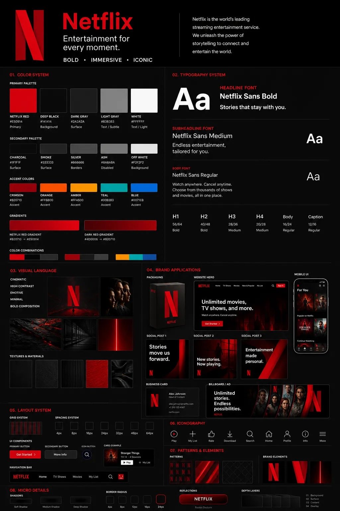
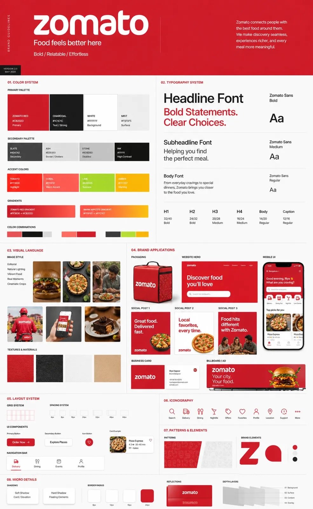

# Bold visuals. Clean design. Stories that sta

- 作者：@Naiknelofar788（simeon-sanai）
- 发布：2026-05-02　·　赞 424　·　浏览 22619
- 原帖：https://x.com/Naiknelofar788/status/2050394546778050915
- 模型：GPT Image 2
- 提示词位置：推文正文

## 原文

```
Bold visuals. Clean design. Stories that stay.

GPT image 2 on ChatGPT

prompt:

This must feel like a real professional brand guideline board
CORE RULE:

Everything must be derived from the uploaded logo:
- colors
- style
- tone
- personality

No generic outputs.

STRUCTURE (VERY IMPORTANT):

Vertical 4:5 poster
Multi-layered grid system
Dense but clean composition

TOP SECTION:

- Brand name (clean typography)
- Short brand statement (max 6 words)
- 3-word brand identity (e.g. “Modern / Bold / Minimal”)

COLOR SYSTEM (ADVANCED):

- Primary palette (3–5 colors)
- Secondary palette (3–5 colors)
- Accent colors

For each:
- large color blocks
- HEX codes (short)
- usage indicators (primary / highlight / background)

Add:
- gradient examples
- color combinations

TYPOGRAPHY SYSTEM:

- Headline font style
- Subheadline style
- Body text style

Show:
- real text examples (short phrases)
- hierarchy clearly visible

VISUAL LANGUAGE:

Define:
- image style (editorial, cinematic, minimal, etc.)
- lighting direction
- texture / material inspiration

Show:
- 3–5 visual tiles (image-style previews)

BRAND APPLICATIONS (VERY IMPORTANT):

Show multiple realistic mockups:

- product packaging
- website hero section
- mobile UI screen
- social media posts (3 variations)
- business card
- billboard or ad

Each must feel consistent with the brand.

LAYOUT SYSTEM:

- UI blocks
- card components
- spacing system

Show:
- buttons, cards, layout examples

ICONOGRAPHY:

- 6–10 icons in brand style
- consistent line / fill style

PATTERNS & ELEMENTS:

- background patterns
- decorative shapes
- visual motifs derived from logo

MICRO DETAILS (TO SHOW POWER):

- shadows
- material textures
- reflections
- depth layers

VISUAL STYLE (CRITICAL):

- modern editorial + tech design hybrid
- extremely clean but information-rich
- layered composition
- strong hierarchy

Typography:
- bold titles
- clean supporting text

DEPTH:

- 30–50 visual elements total
- mix of large + small components
- dense but organized

IMPORTANT RULES:

- no empty space
- no generic placeholders
- everything must feel intentional
- all elements must visually connect

FINAL FEEL:

Like:
- a Behance top project
- a real agency brand guideline board
- something clients would pay for

NOT:
- basic
- minimal
- template-like
```

## 效果图



