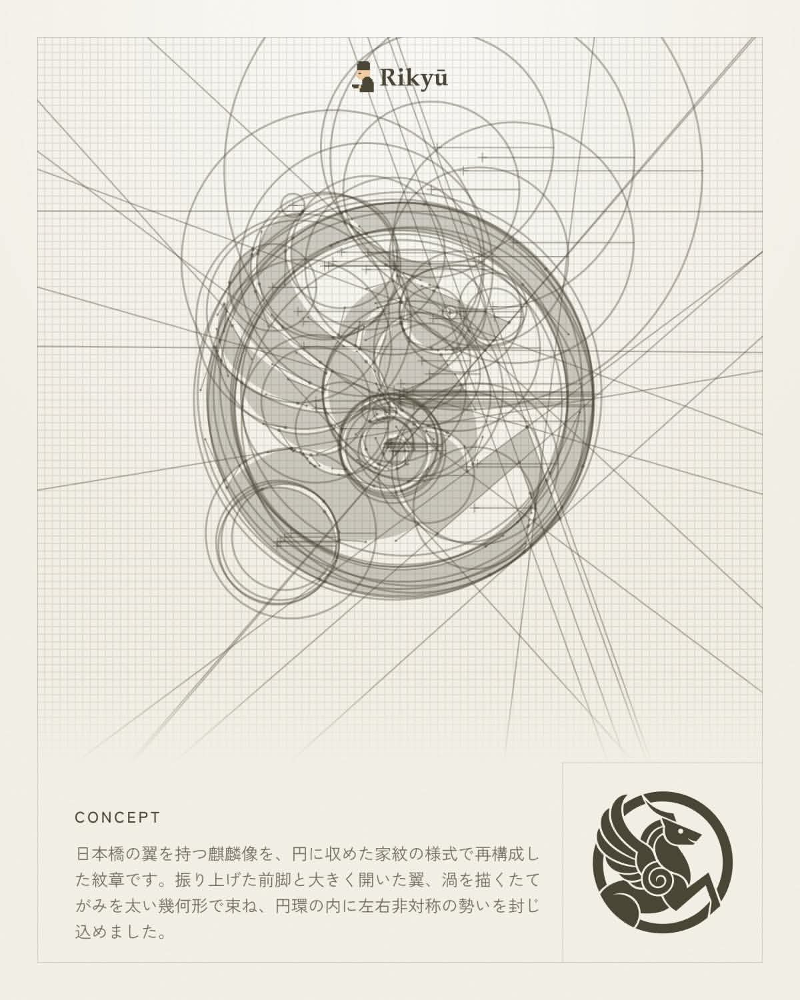
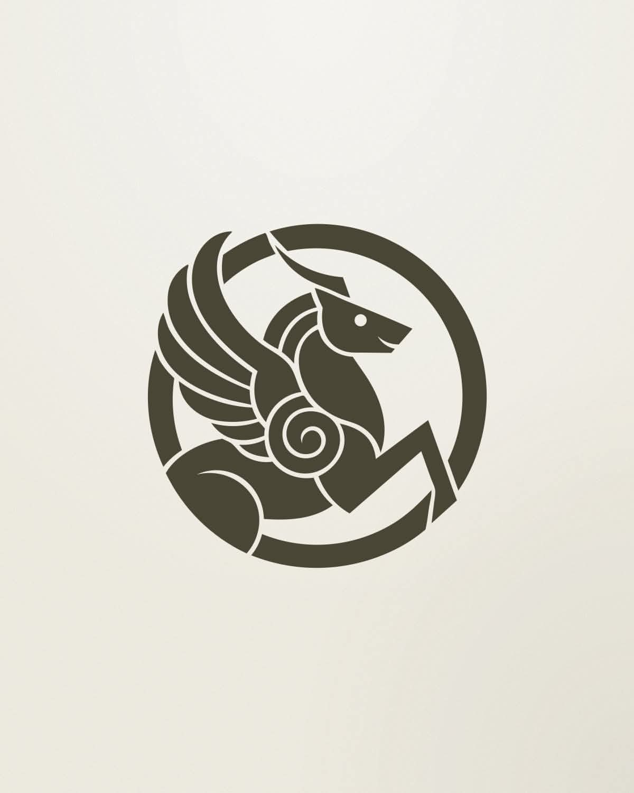
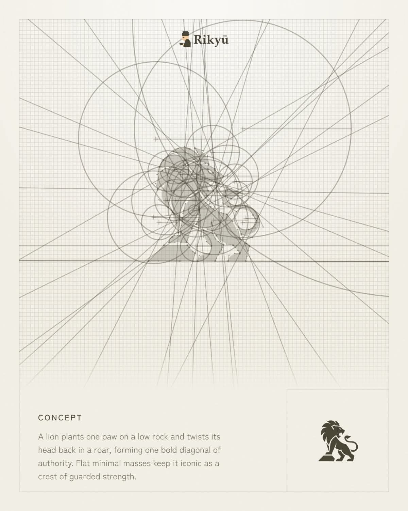
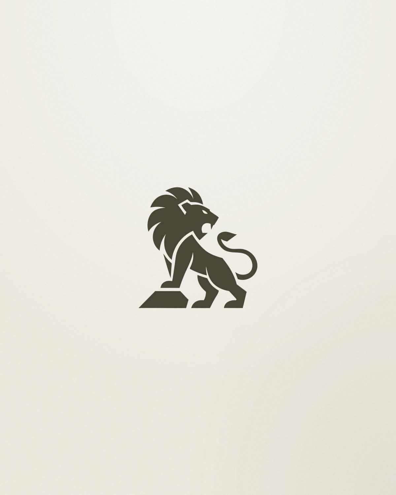

# 目前看到的最猛 AI Logo 工具「Rikyu」。

- 作者：@awe0_io（awe0）
- 发布：2026-10-27　·　赞 7877　·　浏览 598064
- 原帖：https://x.com/awe0_io/status/2114891628561510544
- 模型：GPT Image / Midjourney
- 提示词位置：配图内文字（正文没写，需看图抄）

## 原文

```
目前看到的最猛 AI Logo 工具「Rikyu」。

跟一般 AI 生图不太一样，它是直接用「几何图形去构造 Logo」。

你只要给它一段描述，它就会真的用圆、线条、几何图形去设计。

我觉得这条路线蛮值得关注。

因为如果 AI Design 最后只是「更快地生成图片」，那跟 Midjourney、GPT Image 的差异其实有限。

但如果 AI 开始理解：

比例、几何、版面、视觉系统、设计规则，

那才真的比较像是在取代「设计工具」本身。
```

## 效果图





