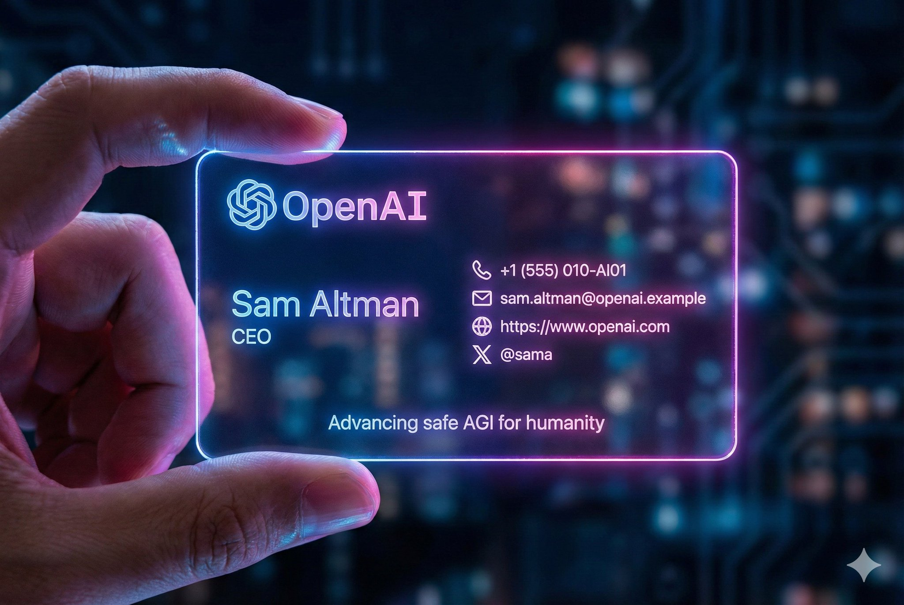
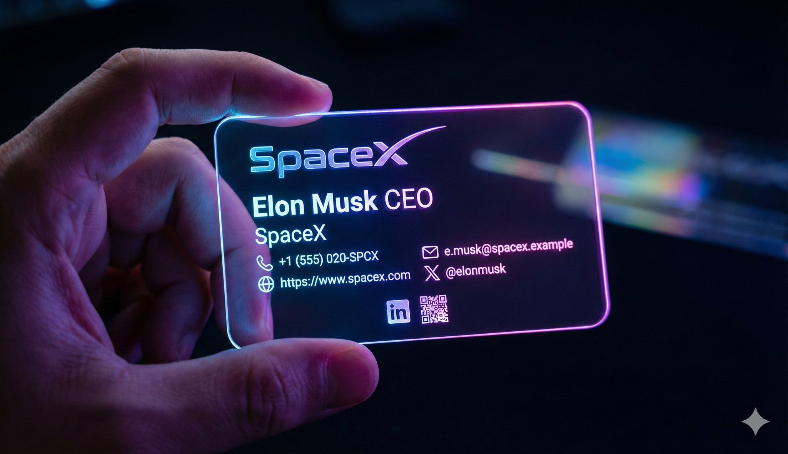
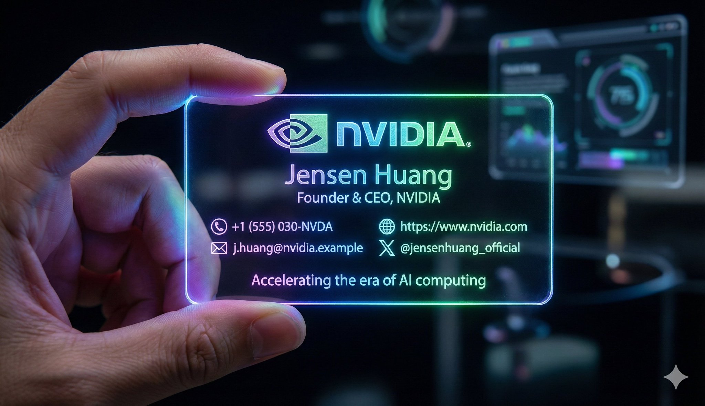
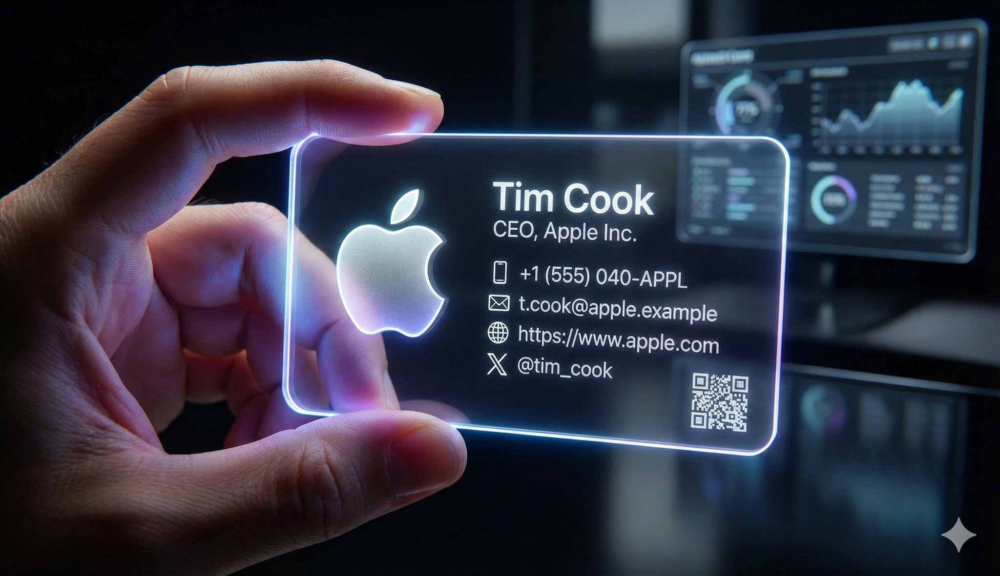

# nano banana pro prompt

- 作者：@dotey（宝玉）
- 发布：2025-12-03　·　赞 1026　·　浏览 182322
- 原帖：https://x.com/dotey/status/1996091290509832533
- 模型：Nano Banana Pro
- 提示词位置：推文正文

## 原文

```
🍌 nano banana pro prompt

A realistic cyber-aesthetic futuristic business card photograph

---- Prompt ----

A realistic cyber-aesthetic futuristic business card photograph: a left hand is holding a horizontal, acrylic, borderless card the size of a standard business card (3.5" × 2" ratio), filling most of the frame. The card displays a personal business card layout without any banners or background images. It features smooth, rounded edges and emits a soft neon glow with gradients of blue, pink, and purple. The background is dark and blurred to highlight the glowing edges, while cinematic reflections of light appear on the fingertips holding the card, creating a high-tech, holographic atmosphere. The card surface is crystal-clear, and the text elements appear finely engraved.
If a logo is provided, integrate it into the design; if not, create a clean typographic logo based on the company name.

If any field is left blank, automatically fill it with visually appealing and context-appropriate design elements.

The final business card should have a balanced layout, clean lines, and clear visual hierarchy, suitable for professional printing.

Name: [Insert Name]
Title: [Insert Title]
Company Name: [Insert Company Name]
Logo: [Use attachment / Create based on company name / Leave blank]
Contact Information: 
  - Phone ( icon ): [Phone Number]
  - Email ( icon ): [Email Address]
  - Website ( icon ): [Website Url]
X (X logo): [X username, e.g. @dotey]
Additional Elements: [Social media / QR code / Tagline / Leave blank]

-----

Name: Sam Altman
 Title: CEO
 Company Name: OpenAI
 Contact Information:
  • Phone (icon): +1 (555) 010-AI01
  • Email (icon): sam.altman@openai.example
  • Website (icon):
 Logo: Create based on company name
 X (X logo): @sama
 Additional Elements: Tagline: “Advancing safe AGI for humanity”
```

## 作者补充的提示词

```
赛博名片

---- 提示词 ----

一张逼真的赛博美学未来名片照片：一只手拿着一张名片大小（3.5" × 2" 比例）的横版亚克力无边框卡片，占据了大部分画面。上面显示着一张个人名片，但没有任何横幅或背景图片。卡片有平滑的圆润边缘，闪烁着柔和的霓虹灯光，呈现出蓝色、粉色和紫色的渐变。背景黑暗而模糊，以突出发光的边缘，握住卡片的手指上的灯光反射看起来富有电影感和氛围感，营造出一种高科技的全息氛围。卡片表面如水晶般清澈，名片上的文字细节仿佛雕刻。

若提供 Logo，请整合进设计；若未提供，则以公司名称设计一款简洁的文字标识性 Logo。
若有字段留空，则根据上下文自动补充合理、美观的设计元素。
最终生成的名片需 布局平衡、线条干净、视觉层次明确，适合专业印刷。

姓名：[填入姓名]
职位：[填入职位]
公司名称：[填入公司名称]
Logo：[查看附件 / 根据公司名称直接绘制 / 留空]
联系方式：
 - 电话（icon）：[电话号码]
 - 邮箱（icon）：[邮箱地址]
 - 官网（icon）： [官网 URL]
 - X (X logo): [X 帐号 / 留空]
 - 微博 (微博 logo): [微博帐号 / 留空]
额外元素：[社交媒体 / 二维码 / 标语 / 留空]

----

姓名：宝玉
职位：CEO
公司名称：红楼梦
Logo：[根据公司名称随机绘制]
联系方式：
 - 电话（icon）：+1(312)000-0000
 - 邮箱（icon）：baoyu@example
 - 官网（icon）：
 - X (X logo): @dotey
 - 微博 (微博 logo): @宝玉xp

额外元素：“我不是花花公子，我只是天性如此”
```

## 效果图





