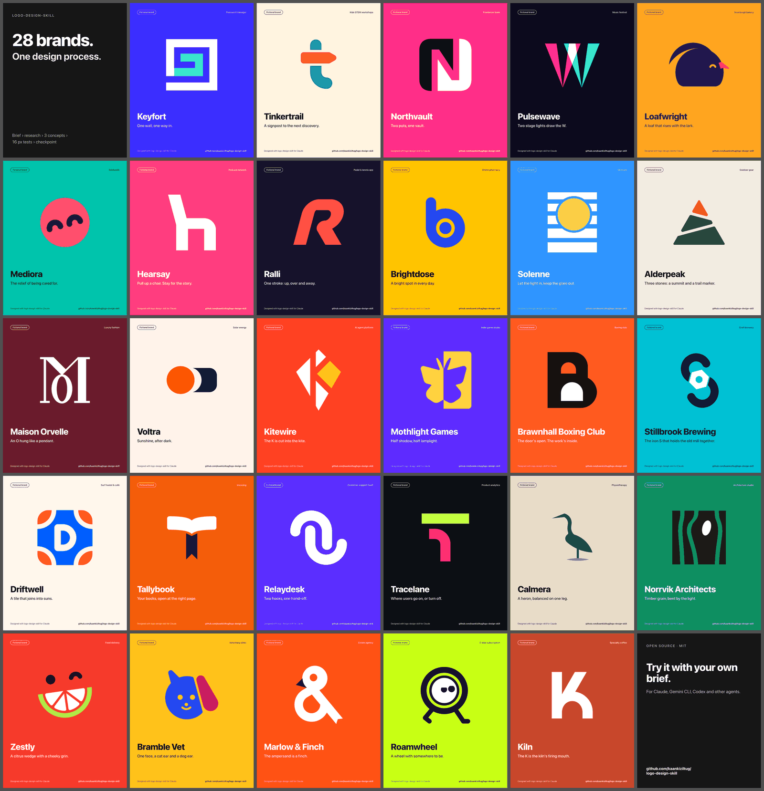

# 真是挖到宝了！！

- 作者：@yyyole（沐阳）
- 发布：2026-10-10　·　赞 448　·　浏览 27413
- 原帖：https://x.com/yyyole/status/2108805100236136717
- 模型：未标注
- 提示词位置：推文正文

## 原文

```
真是挖到宝了！！
感觉可以直接拿来接单变现！

这是我见过最规范的用AI做Logo设计的Skill ！！
一个大神设计师把品牌设计的工作流程、1400多个真实 Logo 参考，以及测试和导出工具，整理成一个 Skill。
看了一下，完全是按照专业设计流程规范来的！

先调研品牌做什么、用户是谁、想传递什么感觉，再研究同行常见的设计。
然后提出 8–12 个创意，从中挑出差异最大的三个，实际画成 SVG。
设计过程中先画黑白稿，确定轮廓和结构后再讨论颜色。
三个方案完成后，还要测试、修改，整理成一张对比图，告诉你推荐哪个、理由是什么。
等你选定方向，再继续制作完整的 Logo 套件。

更有意思的是，这套Skill会完全颠覆常规设计思路！！
比如，咖啡品牌只会画杯子，安全工具只会画盾牌、智能产品只会画大脑......
它会让 Agent 先研究参考库，把品类里用得太多的元素列出来，再探索独特性的表达。

并且完成之后，还会有自检查！
检查SVG 代码还不够，还要渲染成图片检查。
配套的脚本还会自动检查字体依赖、混入的位图、过于复杂的路径、细小到可能消失的结构等问题。
一整套流程下来，确保Logo设计的美观和规范。
最后确认之后，会输出黑白版、单色版、横版和竖版组合、Favicon、App 图标，以及简明使用指南。

作者还开源了 28 个虚构品牌的完整案例，从咖啡店到 SaaS，都能看到概念方案和选定方向的应用效果。
试了一试，确实比几句提示词生成出来的Logo设计图更加高级，关键是放大缩小都不会糊！！

完全可以应对专业场景需求！
开源地址放下面了，有兴趣可以试试！
```

## 效果图


