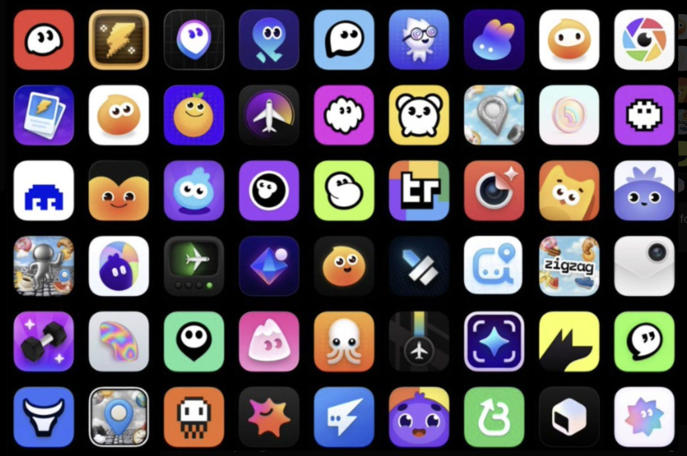

# 据说把这张图喂给 AI，然后使用下面的提示词，你将得到一个有高级感的 app 图标。

- 作者：@LuoSays（Luo说不啰嗦）
- 发布：2026-05-20　·　赞 151　·　浏览 13728
- 原帖：https://x.com/LuoSays/status/2057037850390958329
- 模型：未标注
- 提示词位置：正文只提到提示词（原文在配图/评论）

## 原文

```
据说把这张图喂给 AI，然后使用下面的提示词，你将得到一个有高级感的 app 图标。

“Look at this app icon styles and generate a high-quality app icon for ‘X app’, following the exact same visual style.”
```

## 效果图


