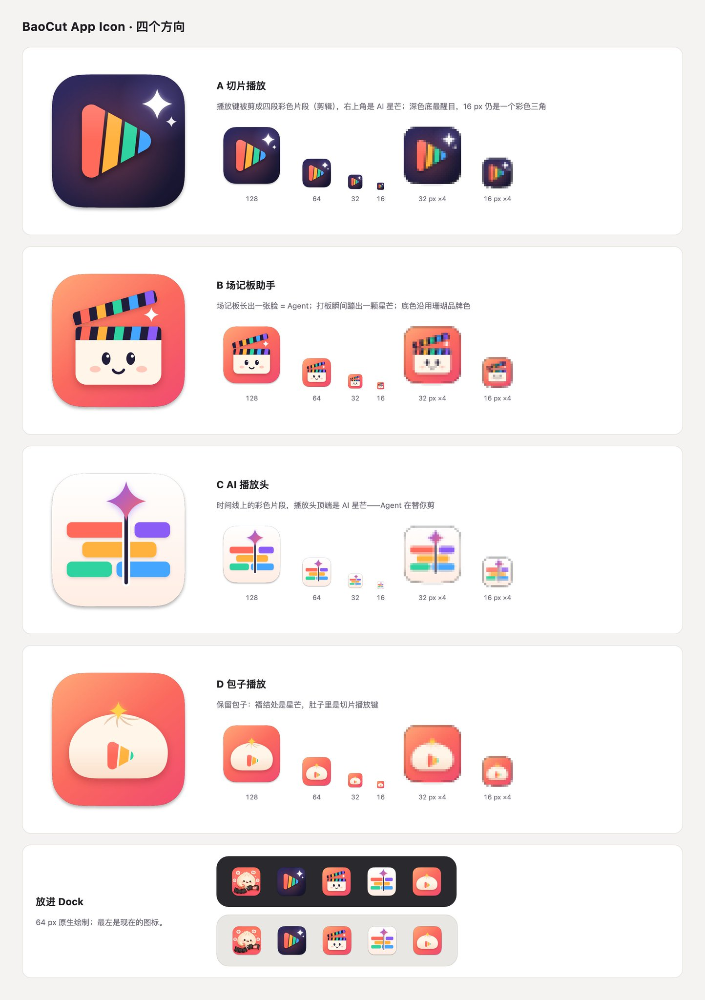
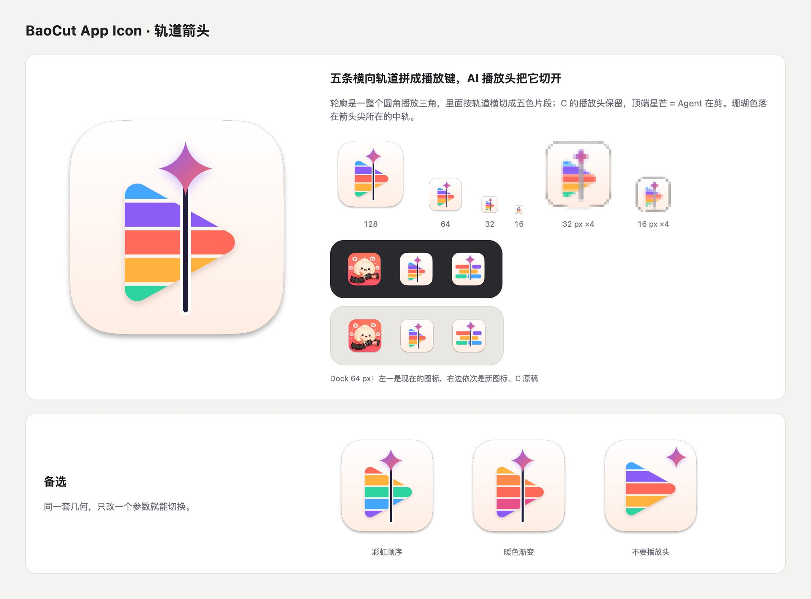
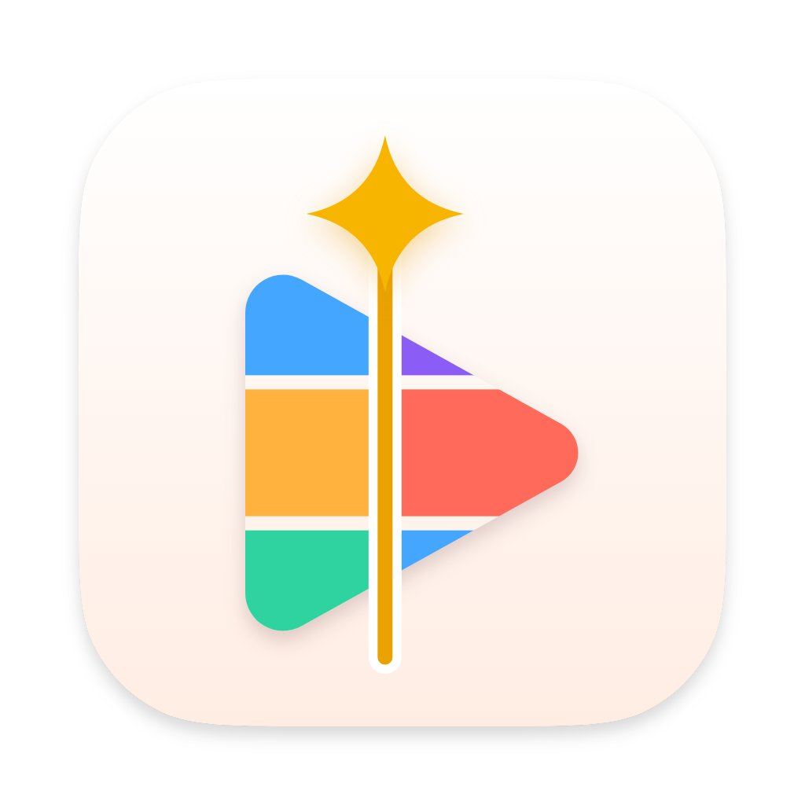

# Opus 5.5 让你实现 App Icon 设计自由

- 作者：@dotey（宝玉）
- 发布：2026-09-27　·　赞 685　·　浏览 120619
- 原帖：https://x.com/dotey/status/2104107699583463686
- 模型：Opus 5.5 / Claude
- 提示词位置：推文正文

## 原文

```
Opus 5.5 让你实现 App Icon 设计自由

当初 Fable 的时候我就尝试过让 Fable 帮我设计 App Icon，但是效果差强人意，最后还是得去用 ChatGPT 画图，但这样画出来的不是矢量的。

这几天用 Opus 5.5 做视频给了我灵感，既然 Opus 5.5 能用 JavaScript + Canvas 一帧帧画出视频，那么让它用 JS + Canvas 画 Icon 就也没问题。

于是我尝试了一下，第一版效果就超出我预期，简洁美观，效果相当不错，提示词就一句话：

> 帮我为  重新设计一个 App Icon，简单一点，彩色的，体现视频编辑、AI Agent
> 可以直接用 js 绘制 canvas

注意重点是“用 js 绘制 canvas”而不是 SVG，SVG 画出来是没有 JS draw Canvas 效果好的。

后面就跟甲方一样不停的让它修改就好：
比如我觉得方案3不错，让它基于方案3去调整，几个版本迭代下来就得到了一个我挺满意的方案。
```

## 作者补充的提示词

```
The prompt is very straightforward: just ask it to draw an app icon using JS on a canvas, and then describe your icon's features and requirements.

In my case, I simply went into my app's source code project (which includes both the code and prototypes) and prompted Claude:

> Please redesign the app icon for  Keep it simple and colorful, and make sure it reflects video editing and AI Agents. Directly draw it on a canvas using JS.
```

## 效果图





