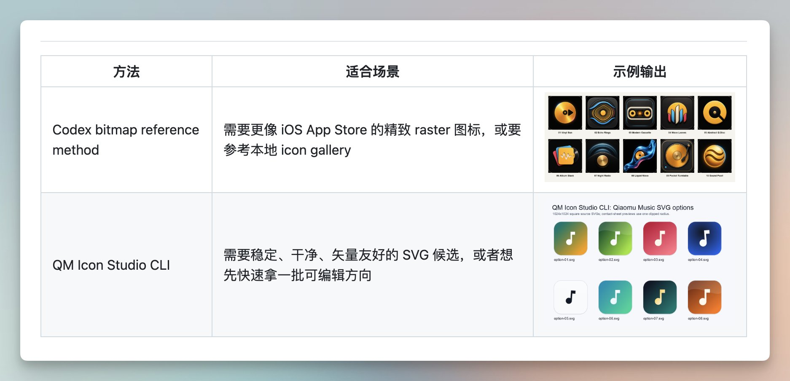

# 不求设计师！Codex一句话生成App图标，加快项目开发速度。

- 作者：@vista8（向阳乔木）
- 发布：2026-06-21　·　赞 134　·　浏览 26449
- 原帖：https://x.com/vista8/status/2068551441048858744
- 模型：未标注
- 提示词位置：配图内文字（正文没写，需看图抄）

## 原文

```
不求设计师！Codex一句话生成App图标，加快项目开发速度。

开源乔木icon设计Skill，支持两种方案：

1. Codex内调用Imagen生图能力，参考小耳@xiaoerzhan收集的几百个图标参考生成。

2. 支持搜索 2w SVG图标，加上纯色或渐变背景生成icon。

无论开发App，还是网页，都可以快速设计图标，挑选使用。当然，精细打磨还是要靠设计师。

Skill安装方法：
npx skills add joeseesun/qiaomu-icon-generator

开源Github地址见评论区
```

## 效果图


