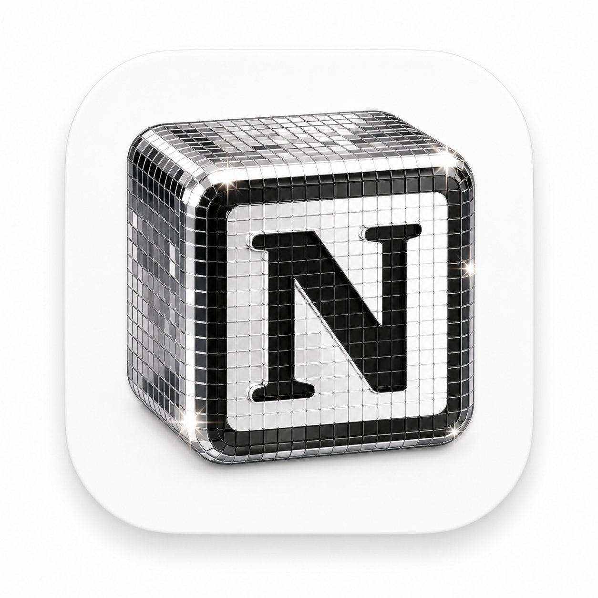
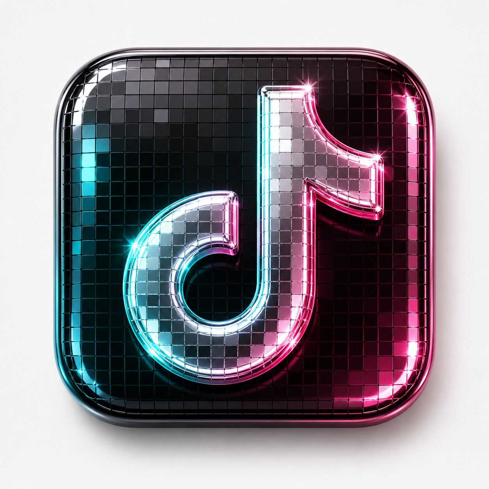

# 哈哈哈，都被Spotify 的迪斯科Logo晃瞎眼了。

- 作者：@vista8（向阳乔木）
- 发布：2026-05-18　·　赞 53　·　浏览 18158
- 原帖：https://x.com/vista8/status/2056308962778296715
- 模型：GPT Image 2 / Kling
- 提示词位置：推文正文

## 原文

```
哈哈哈，都被Spotify 的迪斯科Logo晃瞎眼了。

海外X都在发自己产品设计这种风格 Logo。

反推个GPT-Image-2提示词：

为【品牌名】生成一个高级 3D App 图标，圆角方形底板，玻璃与金属铬材质，迪斯科球镜面马赛克小方块质感，闪亮高光，柔和工作室灯光，干净极简背景，高端产品图标风格，Blender 3D 渲染，超精细

---
英文版：

A premium 3D app icon for 【Product Name】, rounded square tile, glossy glass and chrome material, disco-ball mosaic mirror tiles, sparkling highlights, soft studio lighting, clean minimal background, high-end icon, Blender 3D render, ultra detailed
```

## 效果图





