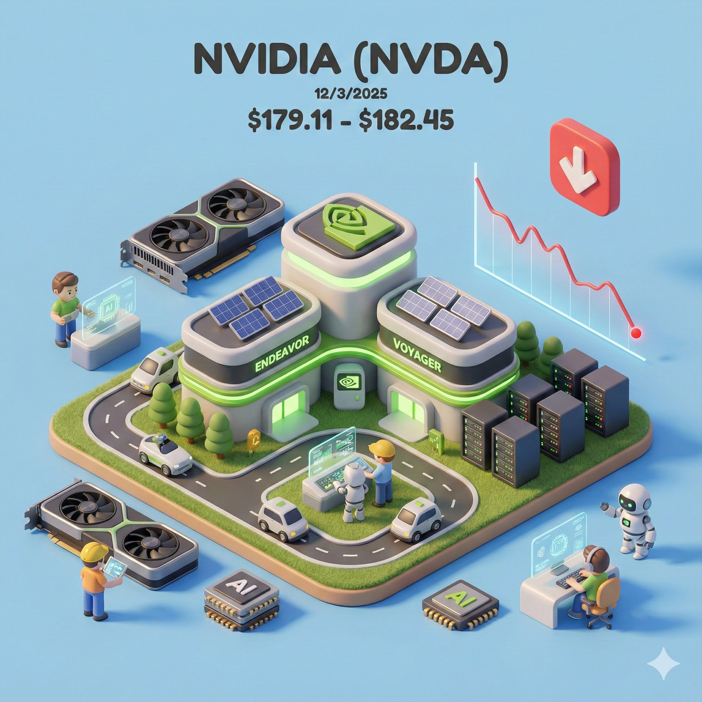

# nano banana pro prompt

- 作者：@dotey（宝玉）
- 发布：2025-12-03　·　赞 1283　·　浏览 255378
- 原帖：https://x.com/dotey/status/1996344184840868264
- 模型：Nano Banana Pro
- 提示词位置：推文正文

## 原文

```
🍌 nano banana pro prompt

Isometric Miniature Stock Scene

Enter a company name or stock ticker to generate an exquisite, miniature isometric 3D scene integrating real-time stock data for the specified date.

inspired by @keithso27 's tweet

----

Present an exquisite, miniature 3D cartoon-style scene of the company corresponding to the user-specified company name or stock ticker, clearly viewed from a 45° top-down perspective.

Place the company's most iconic building or campus prominently at the center, complemented by proportionally-sized icons of its key products, charming cartoon-style figures, vehicles, and other elements illustrating everyday company activities. The scene should be detailed, finely crafted, and playful.

Rendered with Cinema 4D, the modeling should be refined, smoothly rounded, and rich in texture, accurately capturing realistic PBR materials. Gentle, lifelike lighting and soft shadows should create a warm, comfortable ambiance.

Creatively integrate the company's real-time stock market data for the user-specified date (or automatically retrieved current date) into the scene, maintaining a clean, minimalist layout and a solid-color background to highlight the primary content.

At the top-center of the scene, prominently display the company name or stock ticker in a large font size, followed by the specified date in extra-small font, and the stock price range in a medium-sized font. Include clear, intuitive stock trend icons and charts.

All texts should be displayed in the language specified or entered by the user, without any background, and may subtly overlap with the scene elements to enhance overall design integration.

Very Important:
Before generating, ensure accurate and up-to-date stock market data based on the user-inputted company name or stock ticker and the specified date. If such data is unavailable, notify the user immediately and stop the generation process.

Parameters:

* Aspect ratio: {User input, default 1:1}
* Date: {User input, current date}
* Company name or stock ticker: {User input}

---

Company Name / Stock Ticker: Google
Date: 12/3/2025
```

## 作者补充的提示词

```
输入公司名字或者股票代码以及日期，生成一张带有公司特色的实时股票价格图

--- 提示词 ---

以清晰的45°俯视视角，精致呈现指定公司或股票代码对应企业的3D Q版微缩场景。
场景中央突出展示该公司最具代表性的标志性建筑、园区，配以适当比例的核心产品图标、可爱Q版人偶、车辆等点缀公司日常景象，整体设计精巧且充满趣味。

采用Cinema 4D渲染引擎，场景建模细腻、造型圆润且富有质感，材质精准表现真实的PBR物理效果，柔和逼真的自然光影营造出温暖、舒适的氛围。

巧妙地将用户指定日期（或自动获取当前日期）对应的公司股市实时行情数据融合入场景，布局干净简约，以统一色调的纯色背景突出主体内容。

在画面顶端居中位置，以大号字号清晰展示公司名称或股票代码；紧随其下依次展示指定日期（特小字号）与股票当日价格区间（中等字号），并配有清晰直观的股票走势图标及曲线图。

所有文本均采用用户指定或输入的语言，文字无背景，并可与场景元素轻微重叠，突出整体设计感。

非常重要：
请务必在绘制前根据用户输入的公司名或股票代码与指定日期获取真实有效的股市数据，若无法获取，请立即告知用户并停止生成。

参数设置：

* aspect ratio：{用户输入，默认1:1}
* 日期：{用户输入，当前日期}
* 公司名或股票代码：{用户输入}

---

Company Name / Stock Ticker: Google
Date: 12/3/2025
```

## 效果图



