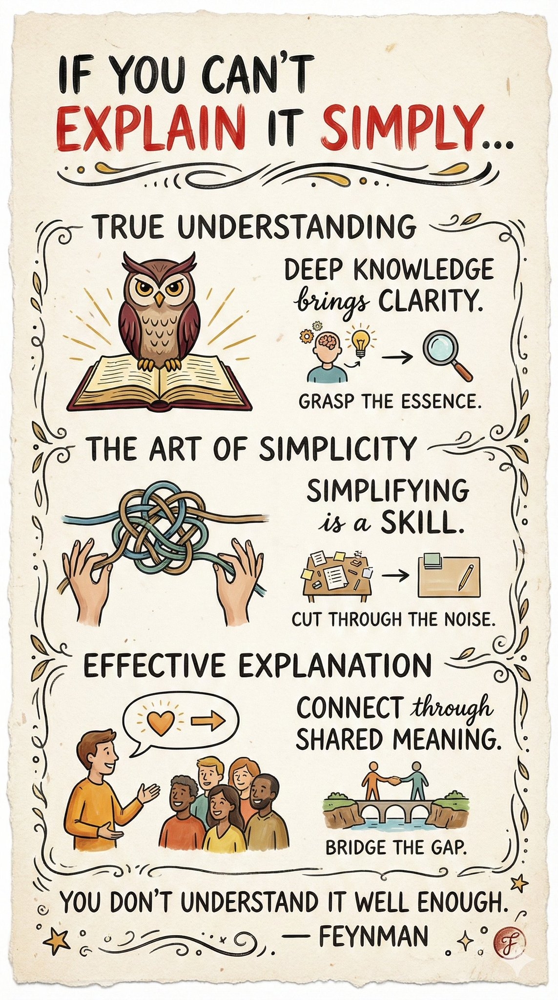

# nano banana pro prompt

- 作者：@dotey（宝玉）
- 发布：2025-12-03　·　赞 286　·　浏览 66802
- 原帖：https://x.com/dotey/status/1996303762428731486
- 模型：Nano Banana Pro
- 提示词位置：推文正文

## 原文

```
🍌 nano banana pro prompt

Create a hand-drawn style infographic card for a topic.

--- Prompt ---

Create a hand-drawn style infographic card in a 9:16 vertical format. The card should have a warm, organic look, with a beige or off-white background featuring subtle paper texture, conveying a friendly and handcrafted aesthetic.

At the top of the card, use a large, expressive brush-stroke lettering style (similar to bold brush calligraphy in English) with strong contrast—primarily in red and black—to highlight the title and draw immediate attention. All text on the card should be written in a flowing hand-painted script style, maintaining an artistic rhythm while ensuring legibility.

Organize the layout into 2 to 4 clearly defined sections, each containing short, concise phrases that express the key ideas. The handwritten script should feel dynamic and natural, enhancing the overall visual harmony.

Add small, simple, and engaging hand-drawn illustrations or symbolic icons—such as characters, objects, or conceptual symbols—to reinforce the message and enhance visual interest. Maintain balanced composition and adequate breathing room, ensuring the design remains clean, readable, and visually appealing.
Theme: {topic}

---

topic: “If you can't explain it simply, you don't understand it well enough.” — Feynman
```

## 效果图


