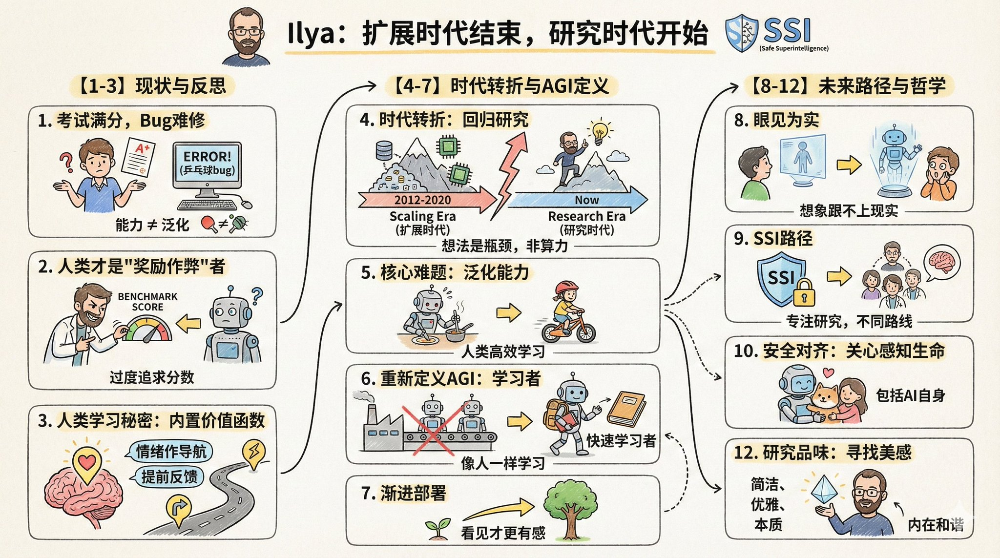

# nano banana pro prompt

- 作者：@dotey（宝玉）
- 发布：2025-11-26　·　赞 689　·　浏览 426012
- 原帖：https://x.com/dotey/status/1993567848564686926
- 模型：Nano Banana Pro
- 提示词位置：推文正文

## 原文

```
🍌 nano banana pro prompt

convert your article/content to a cartoon-style infographic

--- Prompt ---

Please create a cartoon-style infographic based on the provided content, following these guidelines:

- Hand-drawn illustration style, landscape orientation (16:9 aspect ratio).

- Include a small number of simple cartoon elements, icons, or famous personalities to enhance visual interest and memorability.

- If the content includes sensitive or copyrighted figures, replace them with visually similar alternatives; do not refuse to generate the illustration.

- All imagery and text must strictly adhere to a hand-drawn style; avoid realistic visual elements.

- Keep information concise, highlighting keywords and core concepts. Utilize ample whitespace to clearly emphasize key points.

- Unless otherwise specified, use the same language as the provided content.

Please use nano banana pro to create the illustration based on the input provided.
```

## 作者补充的提示词

```
把文章变成卡通信息图的提示词：

请根据输入内容提取核心主题与要点，生成一张卡通风格的信息图：
- 采用手绘风格，横版（16:9）构图。
- 加入少量简洁的卡通元素、图标或名人画像，增强趣味性和视觉记忆。
- 如果有敏感人物或者版权内容，画一个相似替代，但是不要拒绝生成
- 所有图像、文字必须使用手绘风格，没有写实风格图画元素
- 除非特别要求，否则语言与输入内容语言一致。
- 信息精简，突出关键词与核心概念，多留白，易于一眼抓住重点。

请根据输入的内容使用 nano banana pro 画图：
```

## 效果图


