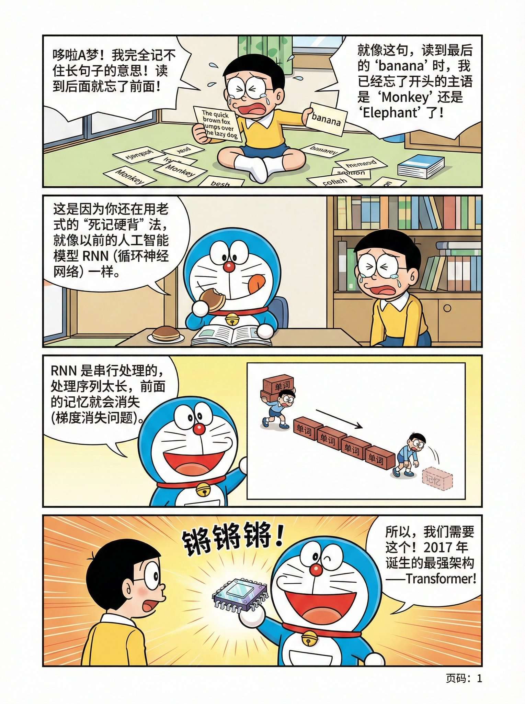
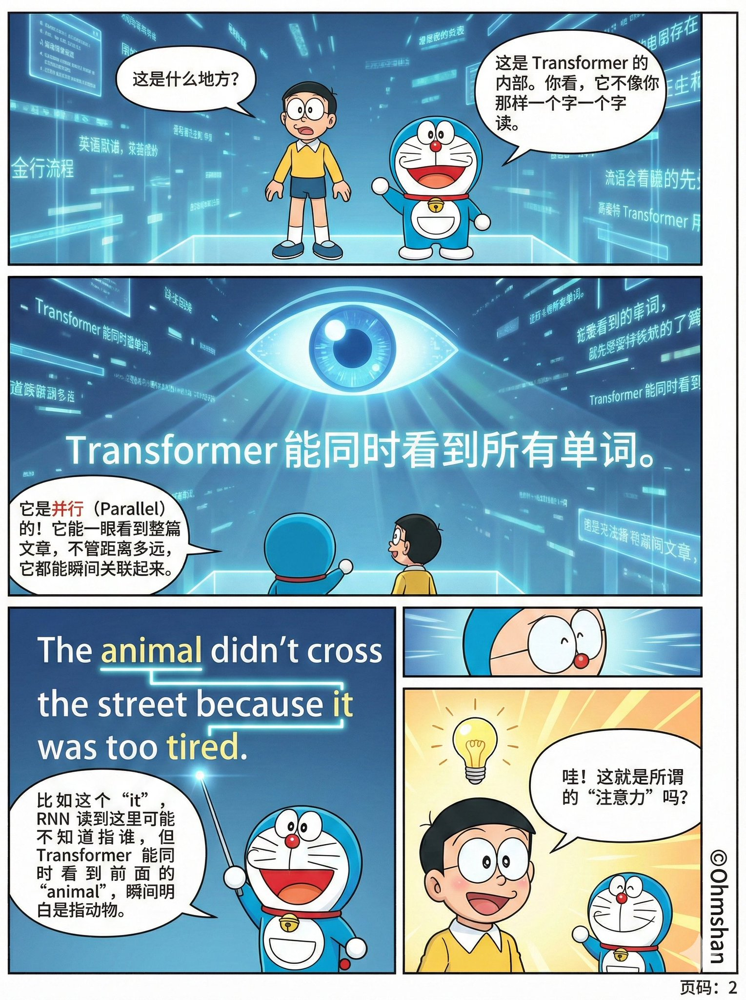
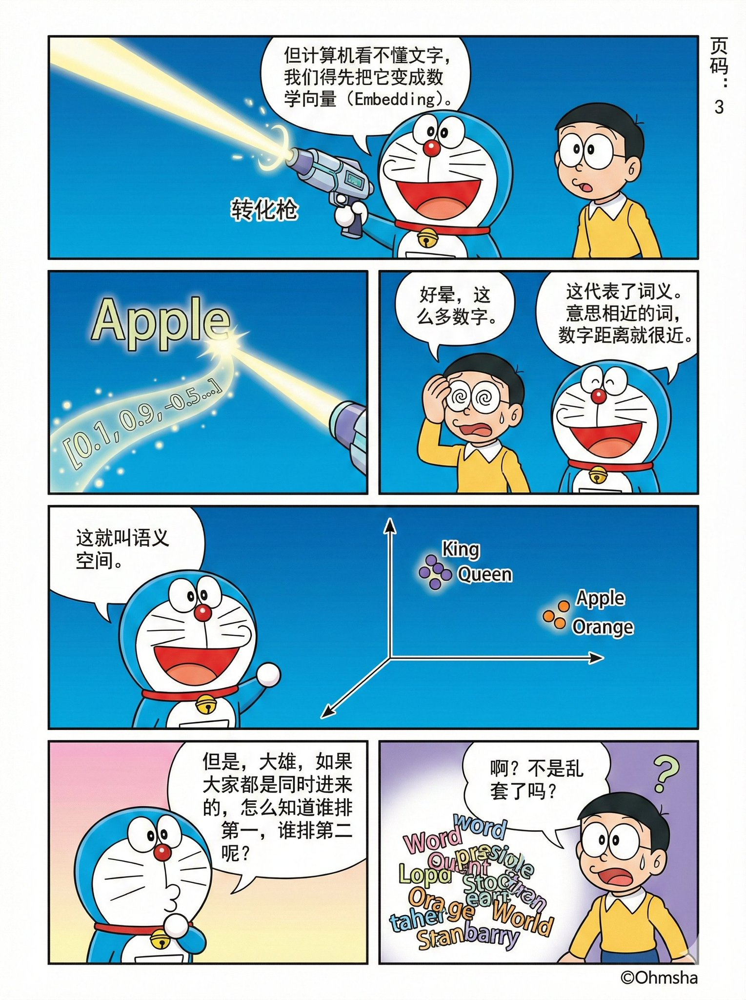
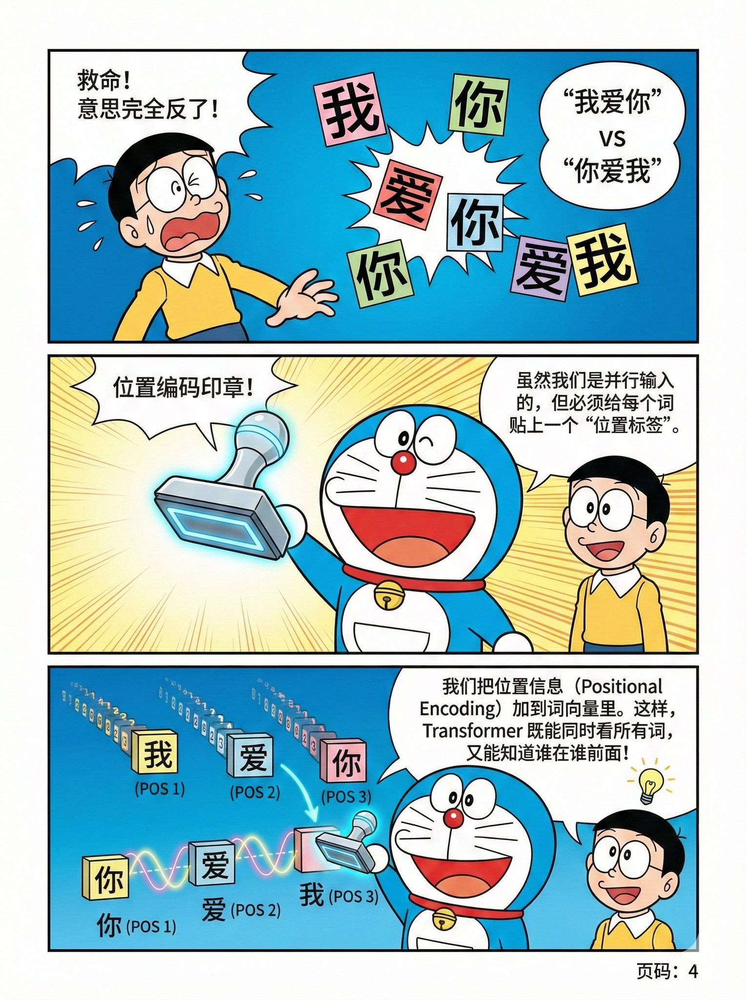

# nano banana pro 的知识漫画 太牛了！！！

- 作者：@howie_serious（howie.serious）
- 发布：2025-11-28　·　赞 442　·　浏览 94200
- 原帖：https://x.com/howie_serious/status/1994297354808381819
- 模型：Nano Banana Pro
- 提示词位置：推文正文

## 原文

```
nano banana pro 的知识漫画 太牛了！！！

《哆啦 A 梦给你讲解 transformer 原理》：深入浅出、具体形象、寓教于乐。

直到现在，nano banana pro 仍然让我震撼。

一个简单的 prompt，就能制作这种级别的漫画：把transformer 原理深入浅出、具体生动，用故事讲出来。

基本工作流很简单：gemini 3.0 pro 设计分镜，然后把12 张漫画分镜给 nano banana pro 一张一张画出来。

transformer 讲解一共 12 张。你仔细读一读，感受一下，这种“知识漫画”到底好不好，价值大不大？

（GOOG 还得加仓🤣）
```

## 效果图





