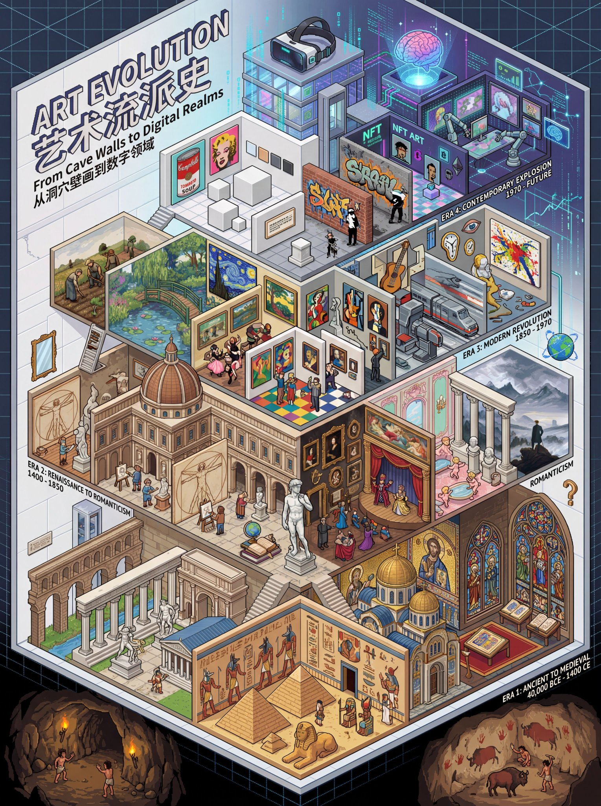

# 找到了一种非常喜欢的nano banana pro玩法：用等角透视像素画风格打造某一领域

- 作者：@sundyme（sundyme）
- 发布：2025-11-29　·　赞 607　·　浏览 87921
- 原帖：https://x.com/sundyme/status/1994598434335330697
- 模型：Nano Banana Pro
- 提示词位置：正文只提到提示词（原文在配图/评论）

## 原文

```
找到了一种非常喜欢的nano banana pro玩法：用等角透视像素画风格打造某一领域的发展纪年史。🍌对像素画的理解真的很到位，像素画的美学风格还原的惟妙惟肖，比如这幅“艺术流派发展史”。完整提示词见评论区，大家可以让Gemini参考这种风格构思生成各种领域话题的像素风可视化海报。
```

## 作者补充的提示词

```
提示词：Create a highly detailed isometric pixel art illustration of art movements history timeline in 3:4 aspect ratio at 4K resolution. This should be an intricate, symbolic, and metaphorical isometric pixel art with bilingual title, focusing on humanity's artistic evolution from cave paintings to contemporary expression.

VISUAL STYLE - SYMBOLIC METAPHORICAL ISOMETRIC PIXEL ART:

Ultra-detailed isometric pixel art with symbolic and metaphorical depth
Extremely fine pixel details with meticulous shading and highlights
Rich
Intricate isometric architecture and environmental elements
Multiple layers of symbolic meaning and visual metaphors
Detailed pixel characters and objects with clear silhouettes
Clean, professional: Profound, symbolic, metaphorical isometric pixel world with layered meaning
CONCEPT VISUALIZATION - ART MOVEMENTS EVOLUTION TIMELINE:
Create a SYMBOLIC ISOMETRIC PIXEL ART scened museum/gallery ascending through time:
Central feature: An isometric pixel art "Museum of Human Expression" with different wings representing eras

The journey shows four major eras:
ERA 1: ANCIENT TO MEDIEVAL (40,000 BCE - 1400 CE)
Prehistoric cave paintings (Lascaux) - primal expression

Ancient Egyptian art - religious and status symbolism
Greek Classical art - harmony and proportion
Roman art - realism and power
Byzantine mosaics - spiritual transcendence
Medieval illuminated manuscripts - religious narrative
Gothic architecture and stained glass
Symbolic elements: Cave walls, pyramids, Greek columns, religious icons, manuscripts
ERA 2: RENAISSANCE TO ROMANTICISM (1400 - 1850)
Renaissance (14th-17th century) - rebirth of classical ideals, humanism
 * Leonardo da Vinci, Michelangelo - mastery of form

Baroque (1600-1750) - drama and grandeur
Rococo (1699-1780) - ornate elegance
Neoclassicism (1750-1850) - return to order and reason
Romanticism (1780-1850) - emotion and nature worship
Symbolic elements: Renaissance studios, dramatic lighting, ornate frames, classical sculptures, wild landscapes
ERA 3: MODERN REVOLUTION (1850 - 1970)
Realism (1848-1900) - everyday life
Impressionism (1865-1885) - capturing light and moment

Post-Impressionism (1885-1910) - symbolic expression
Fauvism (1900-1935) - bold colors
Expressionism (1905-1930) - emotional distortion
Cubism (1907-1914) - fragmented perspectives (Picasso)turism (1909-1920s) - speed and technology
Surrealism (1917-1950) - unconscious mind and dreams
Abstract Expressionism (1940s-1950s) - spontaneous emotion
Symbolic elements: Fragmented forms, bold color palettes, dreamlike imagery, abstract canvases
ERA 4: CONTEMPORARY EXPLOSION (1970 - Future)
Pop Art - consumer culture commentary
Minimalism - reduction to essence

Conceptual Art - ideas over objects
Street Art - democratization of expression
Digital Art - technology as medium
NFT Art - blockchain and ownership
AI-Generated Art - machine creativity
Future: Virtual reality art, bio-art, consciousness art
Symbolic elements: Campbell's soup cans, graffit
```

## 效果图


