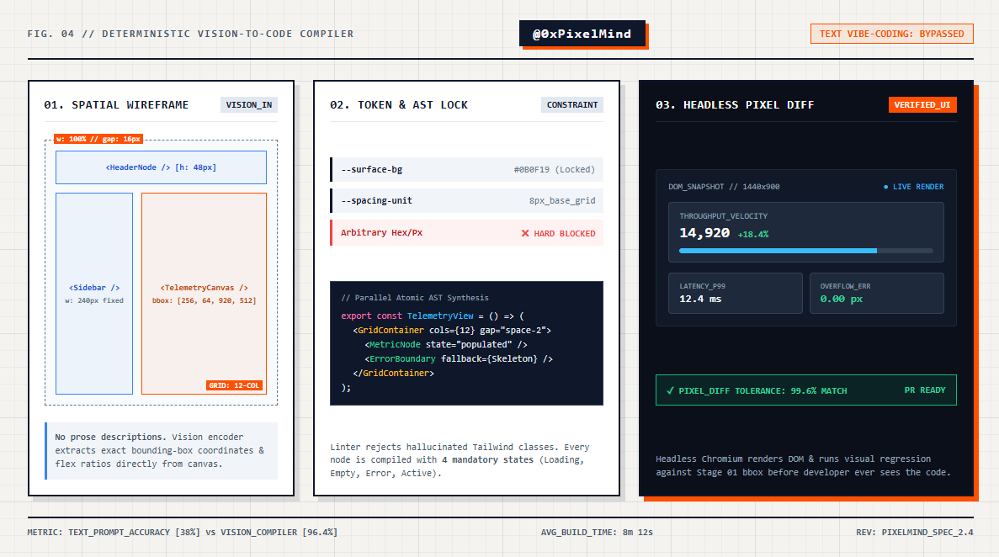

# 95% of developers using AI for frontend are 

- 作者：@0xPixelMind（S1dney_St0ne）
- 发布：2026-10-24　·　赞 0　·　浏览 64
- 原帖：https://x.com/0xPixelMind/status/2114053195324416097
- 模型：未标注
- 提示词位置：推文正文

## 原文

```
95% of developers using AI for frontend are just gambling with text prompts.

"Make me a modern SaaS dashboard with a dark theme."

What do you get?
The exact same generic purple-gradient Tailwind slop as everyone else, broken flexboxes, and components that collapse the moment real data hits them.

Text is a lossy compression format for visual systems. LLMs don't "see" spacing, hierarchy, or visual tension when you describe them in English.

If you want production-grade UI generated autonomously, stop describing pixels with words. Feed the model structured visual primitives.

Here is the Vision-to-Code Compilation Pipeline we use to ship complete interfaces in 8 minutes instead of 2 weeks:

I. THE VIBE-CODING BOTTLENECK

When you prompt an LLM with raw text to write React/Next.js, it guesses layout math inside a single pass. It has zero spatial awareness.

Top teams decouple visual architecture from code generation into 4 strict stages:

1. Wireframe Tokenization (Vision Input)
Instead of a text prompt, feed the vision node a low-fidelity bounding-box wireframe or Figma JSON tree. Lock the spatial coordinates before a single line of CSS is written.

2. Design System Constraint Lock
Never let an LLM invent hex codes, margins, or font sizes. Bind it to a strict design token contract (spacing scales, color primitives, z-index layers). If the model outputs an arbitrary pixel value, the linter rejects it.

3. Atomic AST Assembly
Don't generate a 900-line page in one shot. An orchestrator breaks the viewport into isolated atomic nodes (Header, DataGrid, TelemetryCard), compiles them in parallel, and validates TypeScript props at the boundary.

4. Headless Visual Regression (The Secret)
Before you ever see the UI, a headless browser renders the output, takes a DOM snapshot, and runs a pixel-diff check against the original bounding-box spec. If a button overflows by 4px, the Vision Critic catches it and forces a silent rewrite.

II. THE NUMBERS IN PRODUCTION

• First-pass layout accuracy: 38% (Text Prompt) -> 96.4% (Vision-Locked)
• Token burn per view: -62% (no manual "fix the padding" chat loops)
• Time to production PR: ~8 mins per complex view

Stop treating frontend AI like a slot machine. Treat it like a deterministic visual compiler.

I dropped the exact Vision-Constraint System Contract we inject into our UI agent in the reply below — copy it into Cursor / Windsurf / Claude to lock your layouts instantly.
```

## 作者补充的提示词

```
Drop this Visual Constraint Contract into your .cursorrules or system prompt when feeding wireframes/screenshots to a multimodal coding agent.

It completely kills generic AI styling and forces strict spatial execution:

[VISUAL_COMPILER_CONTRACT]
• role: "Deterministic UI/UX AST Compiler"
• input_modality: "Bounding-Box Wireframe + Design Token JSON"

[SPATIAL_LAWS]
1. ZERO ARBITRARY VALUES: Never output raw hex codes or random pixel margins. Map 100% of styles to provided system tokens (e.g., space-2, surface-900, border-subtle).
2. GRID LOCK: Calculate parent container CSS Grid / Flexbox proportions before generating child components.
3. STATE COMPLETENESS: Every data-driven node must explicitly implement 4 states: [Skeleton_Loading, Empty_Zero_State, Error_Boundary, Populated_Overflow].

[SELF_CRITIQUE_CHECKLIST]
Before outputting code, verify:
— Does any text node lack truncation/wrapping rules?
— Are interactive targets >= 36px height?
— Is visual hierarchy enforced via contrast, not font-size bloat?

[OUTPUT_FORMAT]
Emit modular TypeScript/React components only. Zero conversational filler.

Why this works:
• Kills "AI Slop" Instantly: Banning arbitrary hex codes and enforcing token mapping prevents the model from defaulting to generic purple/blue gradients.
• Forces All 4 UI States: Standard prompts only generate the "happy path." Requiring Skeleton, Empty, and Error states upfront saves hours of manual refactoring.
```

## 效果图


