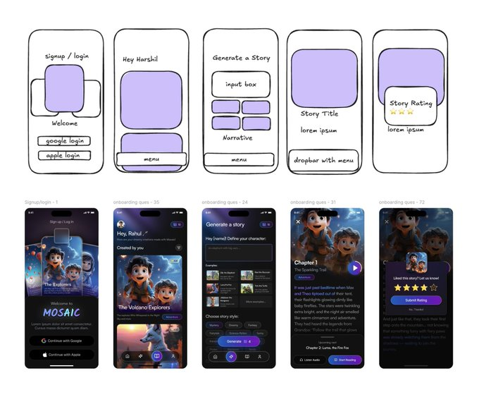

# 90% of apps look vibe coded:

- 作者：@Hartdrawss（Harshil Tomar）
- 发布：2026-02-28　·　赞 604　·　浏览 40570
- 原帖：https://x.com/Hartdrawss/status/2027768326852681798
- 模型：Midjourney / Flux
- 提示词位置：推文正文

## 原文

```
90% of apps look vibe coded:

same purple gradients, same default fonts, same AI slop.

Here’s a workflow to make your app look like it came from a real agency, not a model:

1/ Ship a boring prototype first

> Use Google AI Studio or Cursor to spit out a 1‑shot functional app (e.g. voice journaling).
> Don’t touch the UI. Just list what actually exists now: screens, flows, edge cases.

Function first, vibe later.

2/ Decide how it should feel

> Ask Claude: who is this for, what state are they in, what feeling do we want?
> Turn that into 1–2 paragraphs of brand guidelines: name, vibe words, “analog vs sci‑fi,” what to avoid.

You’re not designing a screen, you’re designing a mood.

3/ Build a reference bank

> Collect images on Pinterest /  / your own Notion: objects, textures, lighting, typography.
> Think “cassette decks and paper notes” or “glass and neon,” not “UI shots.”

This becomes your visual prompt library.

4/ Generate on-theme assets

> Use Flux / Midjourney / Ideogram to create a small set of custom pieces: icon, logo, 1–2 hero illustrations, 1 special button.
> Use negative prompts to kill the generic look: “no glossy, no corporate, no 3D gradients.”
> Clean them up (remove background, tweak colors) so they’re Figma‑ready.

1–3 strong custom elements beat 20 random assets.

5/ Assemble in Figma like a real app

> Drop assets into real iOS / Android frames.
> Stick to an 8px grid, 2 fonts max, one accent color.
> Use blend modes and overlays so the AI art actually matches your background and type.

Now you have a legit, high‑fidelity design, not a screenshot from a model.

6/ Re‑vibe code the app

> Feed the final Figma screens + exported assets back into Google AI Studio or Claude Code.
> Tell it: “Rebuild the existing prototype using this layout, colors, and assets only.”
> Iterate until the code matches the design.
```

## 效果图


