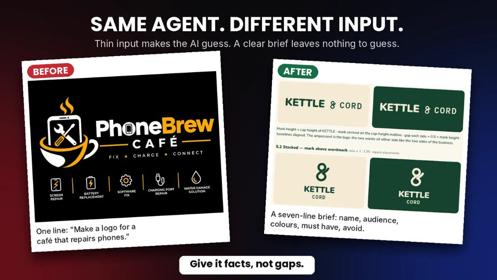

# A good agent can still give you a bad logo. 

- 作者：@Sonofpeace0001（SOP | AI Agent Builder）
- 发布：2026-10-22　·　赞 273　·　浏览 1618
- 原帖：https://x.com/Sonofpeace0001/status/2113145138700583333
- 模型：未标注
- 提示词位置：推文正文

## 原文

```
A good agent can still give you a bad logo. Here's why.

I built a logo agent once, with the rules already inside it. I don't rewrite the prompt each time. I just give it a brief.

The prompt sets the agent up. Your input decides the result.

I tested it twice.

Thin input: "Make a logo for a café that repairs phones."
The agent had to guess. It guessed a coffee cup, steam, a wrench, a screwdriver and lightning bolts, then made up a name.

Solid input: a seven-line brief.
Nothing left to guess. One clean ampersand mark, two colours and spacing rules for each version.

Same agent. Different input. Different result.

This is the input I give it now:

Brand name:
What it is:
Audience:
Personality:
Colours:
Must have:
Avoid:

Once the logo is right, don't start a new chat. Stay in the same conversation and ask the agent to turn it into your full brand system, so everything builds on the mark you already approved.

Bookmark this and fill in the seven lines before your next run. The brief takes a minute. Fixing a guessed logo takes much longer.
```

## 效果图


