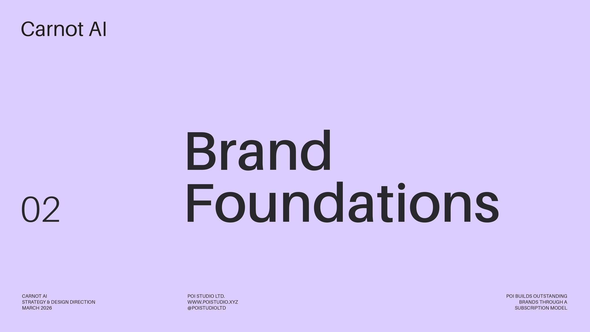
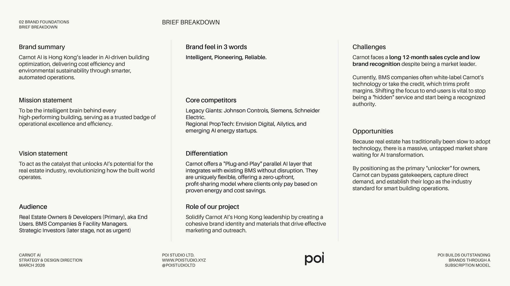

# The 2 ways I actually use AI in my design pr

- 作者：@poistudioltd（Bobo Wong）
- 发布：2026-08-08　·　赞 398　·　浏览 15384
- 原帖：https://x.com/poistudioltd/status/2086013571218149595
- 模型：Midjourney
- 提示词位置：推文正文

## 原文

```
The 2 ways I actually use AI in my design process:

1. Creative imagery.

I've always had ideas that felt too crazy to pull off quickly in Illustrator. This is how I get them out of my head now:

1. Pinterest first. I collect references before I touch MJ, so I know what I'm chasing.
2. Build two moodboards in Midjourney. Grab the style codes from both.
3. Write what I actually want to create, then paste both moodboard codes into the prompt.

2. Digesting workshops.

This saves me hours of work.

After a brand workshop I'm sitting on messy notes, slider results and a recording.

1. I already have a fixed framework for my strategy and design report. Summary of everything we discussed, brief breakdown, brand goals, brand values, moodboard, the vibe framework, then how each design element applies to this brand.
2. I give Claude that framework first. Before anything else.
3. Then I give it all the raw workshop materials.
4. I ask it to create a summary of everything we talked about, using my framework.
5. First draft comes back in a couple of minutes. Then I proofread and rewrite the copy properly, which takes me another hour or two.

It's not analysing for me, it's analysing in a structure I already decided on.

Used to eat my entire day, now it's about two hours max.
```

## 效果图





