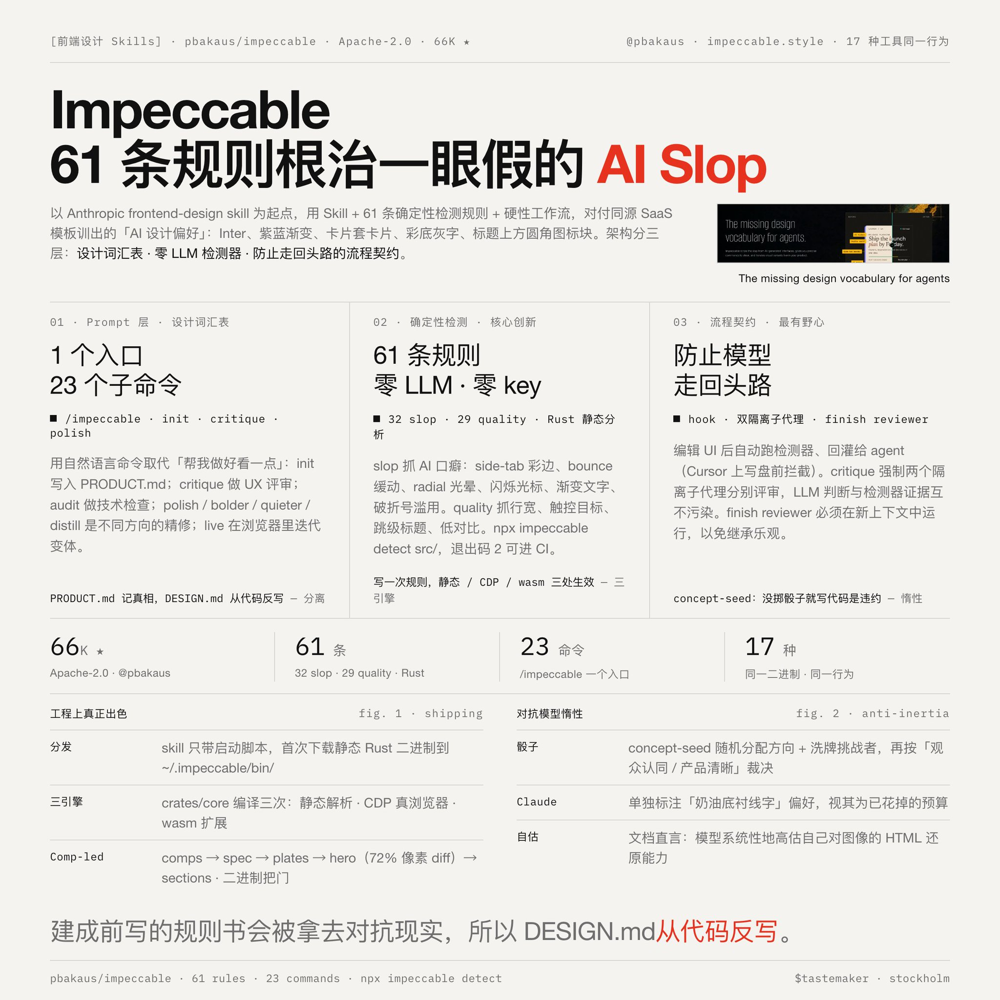

# 前端设计 Skills 分享] Impeccable  66K 🌟

- 作者：@shao__meng（meng shao）
- 发布：2026-09-07　·　赞 25　·　浏览 3926
- 原帖：https://x.com/shao__meng/status/2096919498838483265
- 模型：未标注
- 提示词位置：推文正文

## 原文

```
[前端设计 Skills 分享] Impeccable  66K 🌟

作者 @pbakaus 以 Anthropic frontend-design skill 为起点，通过 Skills + 61 条确定性检测规则 + 硬性工作流，来根治一眼假的 AI Slop ...

AI Slop 从哪来？
所有模型都在同一批 SaaS 模板训练，产出高度趋同的“AI 设计偏好/ AI Slop”：Inter 字体、紫蓝渐变、卡片套卡片、彩色背景上放灰字、每个标题上方一个圆角图标块 ...

# Impeccable 的架构应对分三层

第一层：Prompt 层（Skill 文本）。 1 个 skill 入口 /impeccable，内含 23 个子命令，本质是一套与 AI 共享的设计词汇表——init（采集产品事实写入 PRODUCT.md）、critique（UX 评审）、audit（技术检查）、polish / bolder / quieter / distill（不同方向的精修）、live（浏览器内可视化变体迭代）。用自然语言命令取代模糊的“帮我做好看一点”。

第二层：确定性检测层（核心创新）。 61 条规则全部用 Rust 实现，零 LLM、零 API key 地静态分析 HTML/CSS 或扫描 URL 渲染结果。规则分两类：32 条 "slop"（AI 口癖：side-tab 彩色边条、bounce 缓动、radial 光晕、闪烁光标、渐变文字、破折号滥用……）和 29 条 "quality"（行宽、触控目标、跳级标题、低对比度、越界文本……）。可独立于任何 AI 工具使用：npx impeccable detect src/，退出码 2 即有问题，可直接进 CI。

第三层：流程契约层（最有野心的部分）。 它不只给建议，还把“防止模型走回头路”写成了硬性流程：设计 hook 在你编辑 UI 文件后自动跑检测器、把发现回灌给 agent（Cursor 上甚至在写盘前拦截）；critique 强制两个隔离的子代理分别评审（LLM 判断与检测器证据互相不污染，再合成报告）；finish reviewer 必须在新上下文中运行，因为“继承你转录的评审者会继承你的乐观”。

# 工程上真正出色的几点

1. 无运行时依赖的分发设计。 每份 skill 只带一个几百行的启动脚本，首次运行时下载一个静态 Rust 二进制到 ~/.impeccable/bin/。hook 和 skill 都不需要 Node——npx 只是安装器外壳。这让它在 17 种形态各异的工具里保持同一行为。

2. 同一套核心、三种执行引擎。 crates/core 里的规则逻辑被编译三次：静态引擎（解析 HTML/CSS 级联，无需浏览器）、浏览器引擎（CDP 连真实 Chrome 检查渲染后 DOM）、以及 wasm（打进浏览器扩展和页面内注入 bundle）。写一次规则，处处生效，且行为由 tests/oracle/ 固定。

3. 产品事实与视觉方向分离。 PRODUCT.md 只记“不可协商的产品真相”（用户是谁、差异化机制、证据），DESIGN.md 只记“既成视觉决策”——且明确规定 DESIGN.md 在建成后由 documenter 从代码反写，因为“建成前写的规则书会被拿去对抗现实而不是描述现实”。这个认识很深。

4. 对抗模型惰性的机制化。 最典型的是 concept-seed：新视觉方向必须跑一个脚本随机分配设计方向 + 洗牌挑战者，“写 artifact 代码前没跑这个脚本是违约”。原因是模型天然收敛到品类默认——用骰子强制探索，再用“观众认同 / 产品清晰”两个轴裁决。甚至给 Claude 单独标注了它的“奶油底衬线字”偏好，要求视其为已花掉的预算。

5. Comp-led 构建的状态机。 选了“先出高保真设计稿”路径时，构建被拆成 comps → spec（网格测量设计稿、从 Google Fonts 指纹索引匹配字体）→ plates（图块资产以 1.5 倍分辨率重生成）→ hero（首屏与设计稿像素 diff，72% 过线）→ sections → motion → responsive 的门控流水线。每一关由二进制测量把关，不靠模型“自我感觉复现成功了”——文档直言“模型系统性地高估自己对图像的 HTML 还原能力”。
```

## 效果图


