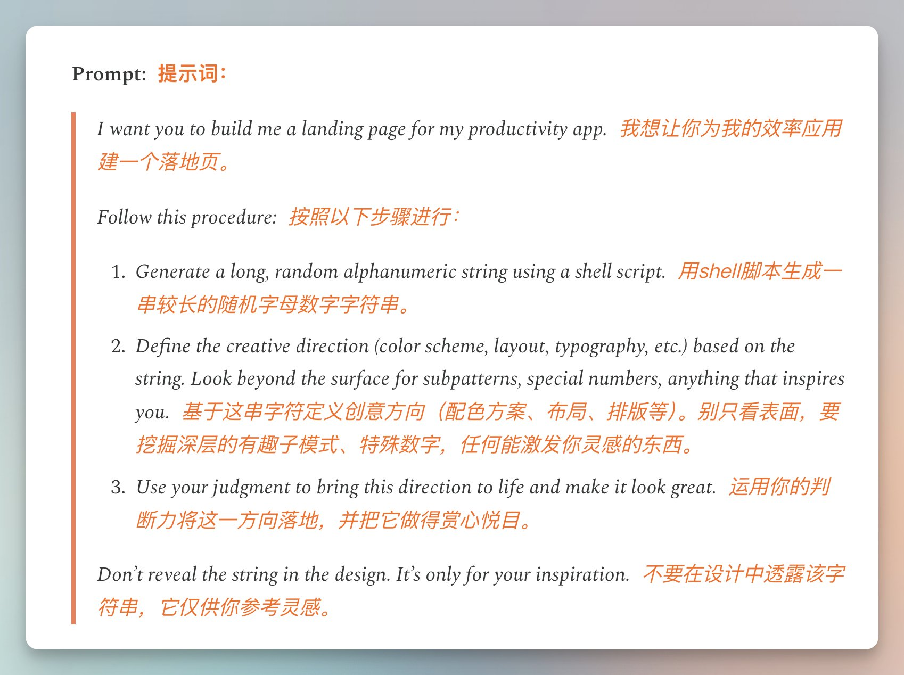

# 我去，著名产品人Lenny这篇文章的含金量太高了！

- 作者：@vista8（向阳乔木）
- 发布：2026-09-04　·　赞 500　·　浏览 46091
- 原帖：https://x.com/vista8/status/2095680322272952448
- 模型：未标注
- 提示词位置：正文只提到提示词（原文在配图/评论）

## 原文

```
我去，著名产品人Lenny这篇文章的含金量太高了！

从大模型原理出发，给出提示词示例，让你学会用AI给出真正有创意、有个人风格的 UI 设计。

比如大模型只是下一个token预测，所以提示词中用shell脚本生成随机数。

让模型基于随机数来定义创意方向！

文中还有其他技巧，提示词价值还是被低估了。

阅读地址见评论
```

## 效果图


