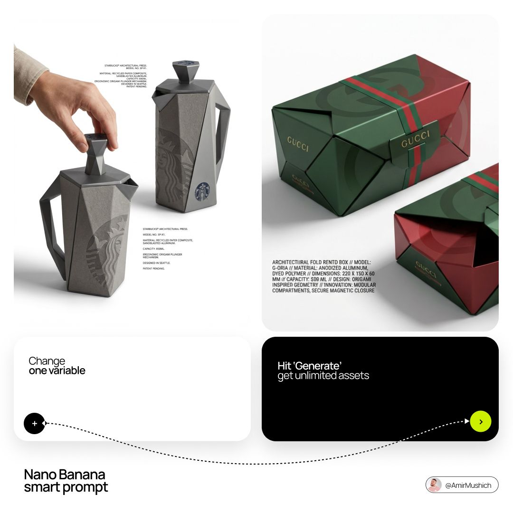

# Nano Banana smart prompt:

- 作者：@AmirMushich（AmirMušić）
- 发布：2026-03-13　·　赞 141　·　浏览 9166
- 原帖：https://x.com/AmirMushich/status/2032532246641406264
- 模型：Nano Banana
- 提示词位置：正文只提到提示词（原文在配图/评论）

## 原文

```
Nano Banana smart prompt:

Conceptual packaging design

Prompt 👇
```

## 作者补充的提示词

```
Prompt:
(access Nano Banana 2 here:

[BRAND NAME]: The core identity.

[CATEGORY]: Clothing / Food / Automotive / Lifestyle.

Goal: Generate a premium industrial design concept on a PURE WHITE background.

1. INNOVATION & OBJECT

- Select one mundane functional object from [CATEGORY].

- Redesign it using unconventional, architectural, or origami-inspired geometry.

- The object must look like a high-end designer invention, not a standard product.

2. UNIFIED COMPOSITION

- Environment: A seamless, pure white studio background with a flat white floor.

- Interaction: A human hand (natural texture) is shown using the object in the foreground, demonstrating its unique ergonomics.

- Static Display: Right next to the hand, the same object is placed in a static, perfect pose to show its full silhouette and branding.

- Shadows: Soft, realistic grey drop shadows on the white floor to provide depth and ground the objects.

3. BRANDING & TEXT

- Identity: Apply the "[BRAND NAME]" logo in a high-contrast dark color (Black or Navy) directly onto the object's surface.

- Technical Detail: Add small, elegant blocks of justified "specification text" in the white negative space around the objects for an editorial look.

- Pattern: Use a subtle, oversized abstract fragment of the brand's logo as a texture on the object's material.

4. MATERIALS & FINISH

- High-quality matte materials only: heavy-duty recycled paper, sandblasted metal, or soft-touch polymer.

- Sharp architectural lines and clean, premium craftsmanship.
```

## 效果图


