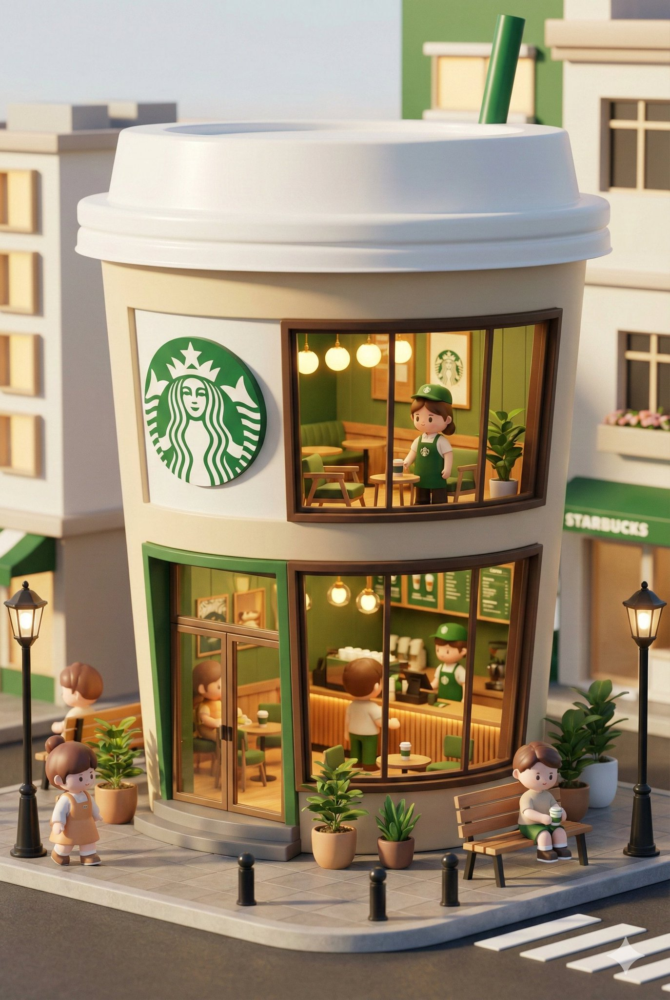
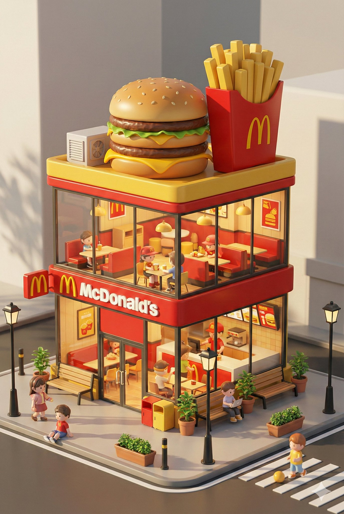
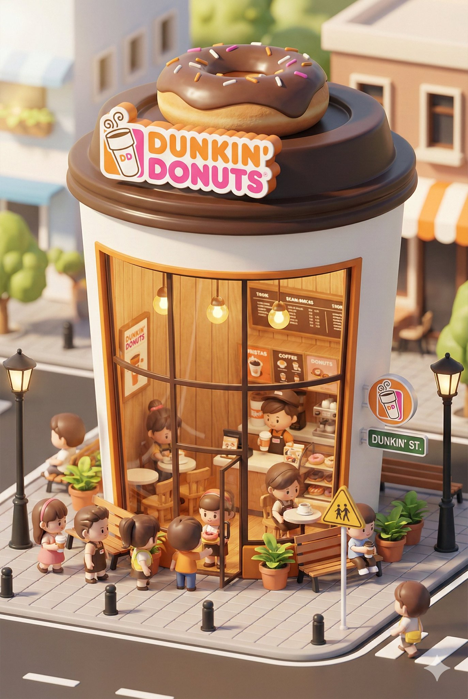
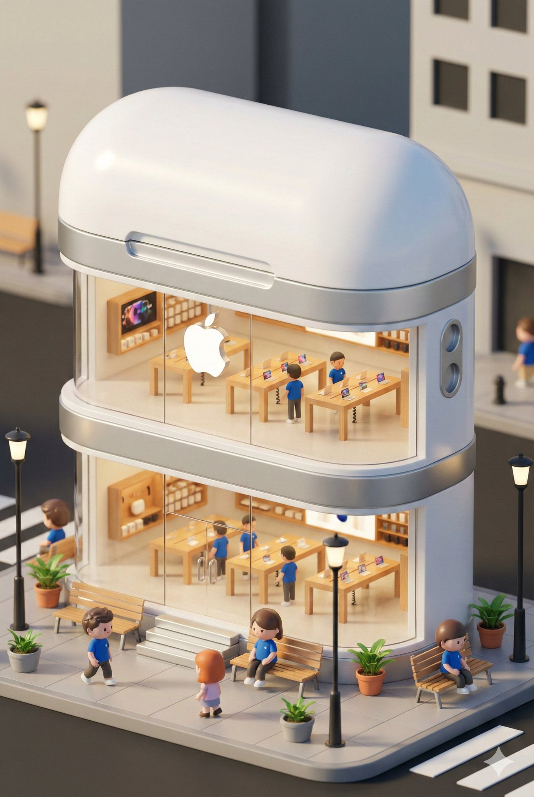

# nano banana prompt

- 作者：@dotey（宝玉）
- 发布：2025-11-30　·　赞 2331　·　浏览 938310
- 原帖：https://x.com/dotey/status/1995190286775881780
- 模型：Nano Banana Pro
- 提示词位置：推文正文

## 原文

```
🍌 nano banana prompt
3D chibi-style miniature concept store of {Brand Name}

--- Prompt ---

3D chibi-style miniature concept store of {Brand Name}, creatively designed with an exterior inspired by the brand's most iconic product or packaging (such as a giant {brand's core product, e.g., chicken bucket/hamburger/donut/roast duck}). The store features two floors with large glass windows clearly showcasing the cozy and finely decorated interior: {brand's primary color}-themed decor, warm lighting, and busy staff dressed in outfits matching the brand. Adorable tiny figures stroll or sit along the street, surrounded by benches, street lamps, and potted plants, creating a charming urban scene. Rendered in a miniature cityscape style using Cinema 4D, with a blind-box toy aesthetic, rich in details and realism, and bathed in soft lighting that evokes a relaxing afternoon atmosphere. --ar 2:3

Brand name: Starbucks
```

## 作者补充的提示词

```
提示词：

3D Q版迷你风格，一个充满奇趣的迷你 {品牌名称} 概念店，建筑外观设计灵感来自于该品牌最具代表性的产品或包装（例如巨大的 {该品牌核心产品，如：炸鸡桶/汉堡/甜甜圈/烤鸭} ）。

建筑共两层，大大的玻璃窗清晰地展示出内部温馨而精致的设计：{品牌主色调} 的装饰风格、温暖的灯光以及忙碌的店员们 {与品牌匹配的穿着}。街道上有可爱的小人偶漫步或坐着，四周布置着长凳、街灯和植物盆栽，营造出迷人的城市一角。整体采用城市微缩景观风格，C4D渲染，盲盒玩具质感，细节丰富、逼真，画面光线柔和、呈现出午后的惬意感受。--ar 2:3

品牌名称：星巴克咖啡
```

## 效果图





