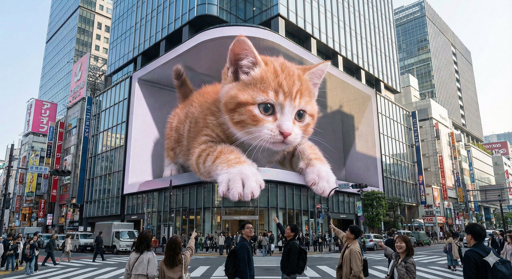
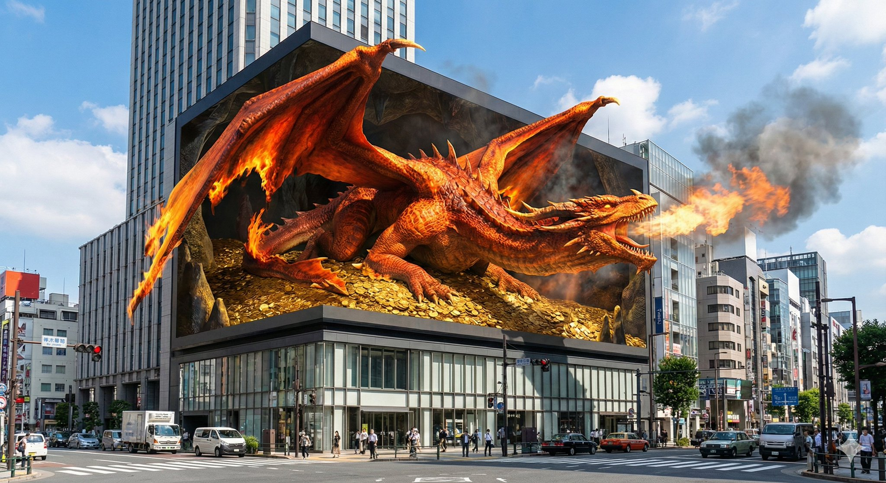
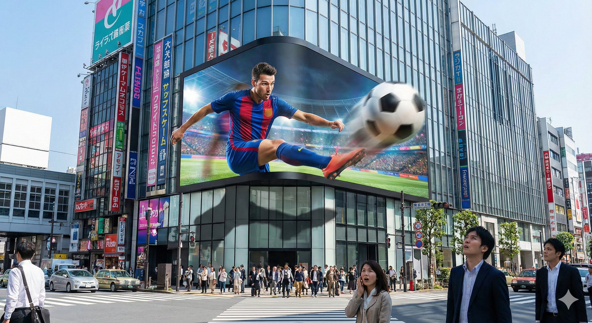
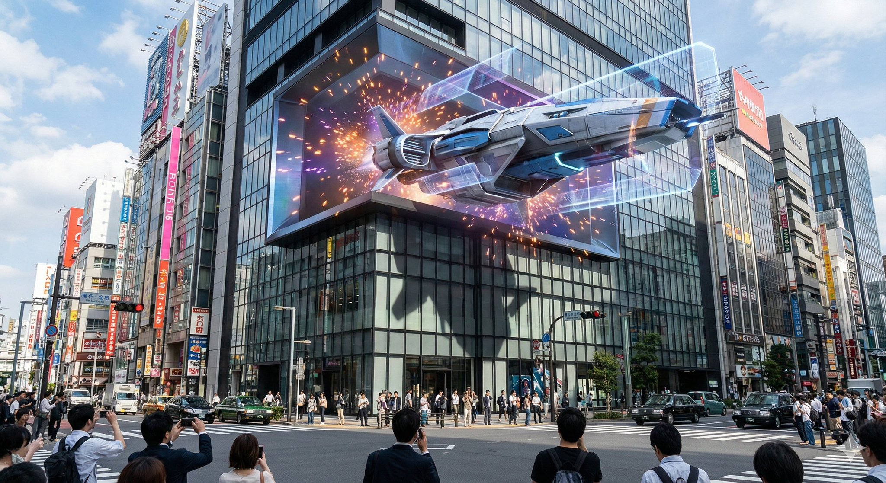

# nano banana pro Prompt

- 作者：@dotey（宝玉）
- 发布：2025-12-07　·　赞 856　·　浏览 451933
- 原帖：https://x.com/dotey/status/1997574511705657772
- 模型：Nano Banana Pro
- 提示词位置：推文正文

## 原文

```
🍌 nano banana pro Prompt

Experience stunning glasses-free 3D visuals on an iconic urban LED display—where fantasy and reality merge seamlessly at the heart of the city.

--- Prompt ---

An enormous L-shaped glasses-free 3D LED screen situated prominently at a bustling urban intersection, designed in an iconic architectural style reminiscent of Shinjuku in Tokyo or Taikoo Li in Chengdu. The screen displays a captivating glasses-free 3D animation featuring [scene description]. The characters and objects possess striking depth and appear to break through the screen’s boundaries, extending outward or floating vividly in mid-air. Under realistic daylight conditions, these elements cast lifelike shadows onto the screen’s surface and surrounding buildings. Rich in intricate detail and vibrant colors, the animation seamlessly integrates with the urban setting and the bright sky overhead.

----
scene description:
[An adorable giant kitten playfully paws at passing pedestrians, its fluffy paws and curious face extending realistically into the space around the screen.]
```

## 作者补充的提示词

```
🍌 nano banana pro 提示词
生成裸眼 3D 大屏图片，可以使用文本或者图片描述剧情。尽情发挥你的想象力。

--- 提示词 ---

位于繁忙城市街角的一个巨大L型裸眼3D LED屏幕，其结构和建筑风格类似于日本新宿或成都太古里的地标性屏幕。屏幕上正播放着一段令人惊叹的裸眼3D动画：[剧情描述]。角色和物体具有强烈的立体感，仿佛打破了屏幕的边界，向外延伸或浮现在空中，并在真实的日光下在屏幕表面和周围的建筑物上投射出逼真的阴影。场景细节丰富，色彩鲜艳，与周围的城市环境和蓝天白云融为一体。

----

剧情描述：
屏幕化作一个堆满金币的黑暗洞穴。一条浑身燃烧着烈焰的西方巨龙正在沉睡，突然被惊醒。它愤怒地展开双翼，翅膀尖端延伸出屏幕两侧的物理边界。它伸长脖子，将巨大的龙头探出洞穴（屏幕），鼻孔喷出的火焰和烟雾在屏幕外的空气中弥漫，它张嘴咆哮，仿佛热浪正扑面而来。
```

## 效果图





